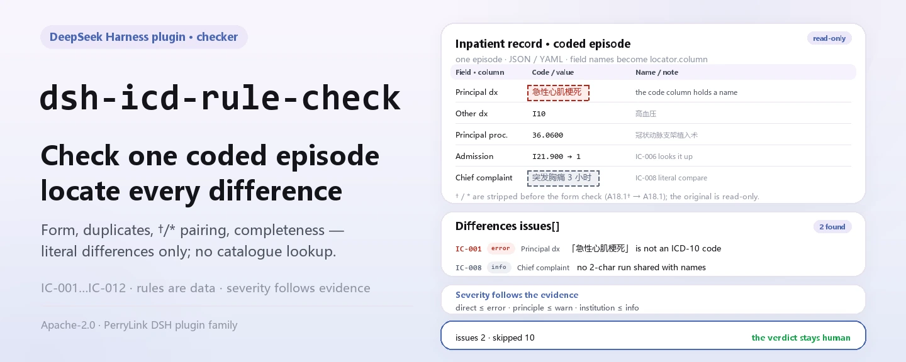
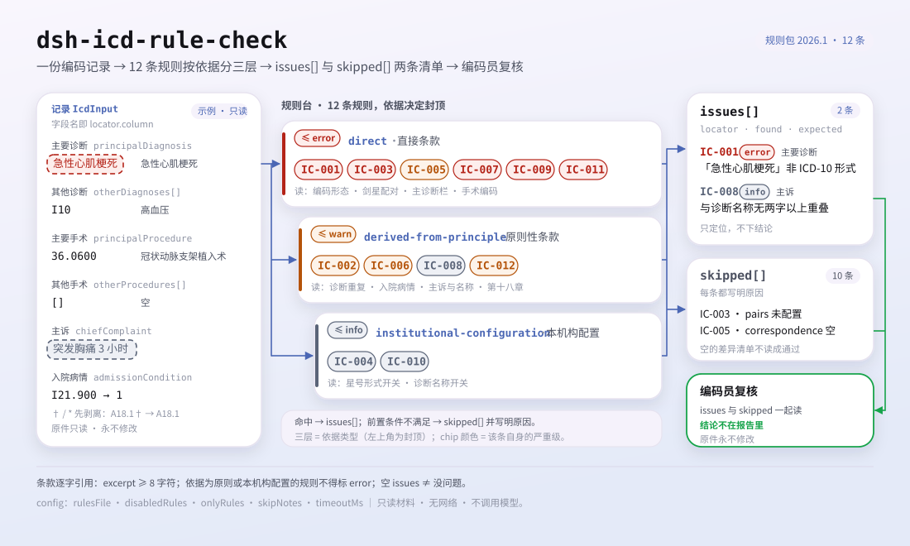

<div align="center">

<picture>
  <source media="(prefers-color-scheme: dark)" srcset="docs/assets/dsh-icd-rule-check-hero-en-dark.webp">
  
</picture>

# dsh-icd-rule-check

**Check one coded inpatient episode for ICD-10 and ICD-9-CM-3 code form, duplicates, dagger/asterisk pairing and field completeness — and get back a list of what is inconsistent, where, and what to fix.**

A DeepSeek Harness checker for medical coders and quality-control staff: the rule pack quotes its public clauses verbatim, reports only literal differences against the cited clauses, and never decides compliance, assigns liability, looks a code up in a catalogue, or touches your original.

<picture>
  <source media="(prefers-color-scheme: dark)" srcset="docs/assets/dsh-icd-rule-check-flow-v5-dark.svg">
  
</picture>

[Install](#three-step-setup) · [Configuration](#configuration) · [FAQ](#faq) · [简体中文](README.md) · [English](README.en.md) · [Español](README.es.md) · [Português](README.pt.md) · [हिन्दी](README.hi.md)

[](LICENSE)
[](#compatibility)
[](https://www.npmjs.com/package/dsh-icd-rule-check)
[](https://github.com/PerryLink/dsh-icd-rule-check/actions/workflows/ci.yml)
[](#compatibility)

[](https://github.com/PerryLink/dsh-icd-rule-check/stargazers)
[](https://www.npmjs.com/package/dsh-icd-rule-check)
[](https://dshfind.com/plugins/PerryLink/dsh-icd-rule-check?ref=badge)
[](https://securityscorecards.dev/viewer/?uri=github.com/PerryLink/dsh-icd-rule-check)
[](https://dsh.market/)
[](https://gitee.com/perrylink/dsh-icd-rule-check)

```sh
dsh plugin --profile <name> add dsh-icd-rule-check
```

</div>

<sub>Community plugin, not affiliated with DeepSeek. Canonical repository: <https://github.com/PerryLink/dsh-icd-rule-check> (Gitee is a mirror).</sub>

## What it is

`dsh-icd-rule-check` reads one coded inpatient episode — the principal diagnosis, the other diagnoses, the principal procedure, the other procedures and the admission-condition codes — and checks that episode's own structure and cross-references: that every diagnosis code has ICD-10 form and every procedure code ICD-9-CM-3 form (the † / * markers are stripped before the form test), that the same diagnosis code is not listed twice, that an asterisk code has its dagger partner in the same episode, that a principal diagnosis is present, and that the fields each check needs are filled. You hand it the source material (JSON or YAML; Excel can be converted to JSON/YAML first, in chat if the platform supports it) and it returns a list of differences. It does not decide compliance, does not assign liability, does not replace the reviewer, never looks a code up in a catalogue, and never modifies the original.

## Three-step setup

1. **Install**:

   ```sh
   dsh plugin --profile <name> add dsh-icd-rule-check
   ```

   Alternatively, search "Medical Record QC Suite" in WorkBuddy / Coze (the full set; this check is one part of it; availability as listed).

2. **Minimal config** (works out of the box):

   ```yaml
   - insert:
       - id: dsh-icd-rule-check
         name: dsh-icd-rule-check
   ```

   Every tunable lives in the Schemastery schema in `src/config.ts` and the defaults are production-ready; per-rule thresholds live in the rule pack under `rules/`.

3. **Verify it mounts**:

   ```sh
   dsh --profile <name> --dump-config | grep 'dsh-icd-rule-check'
   ```

   Run `pnpm run build` first to create `lib/`, then run the bundled sample (about a minute):

   ```sh
   node samples/quickstart/run.mjs --check
   ```

   The sample input lives in `samples/quickstart/input/`, the expected output in `samples/quickstart/expected/result.json`, and the run screenshot in `docs/assets/quickstart.png`. The README images are generated programmatically by [`scripts/gen-readme-assets.py`](scripts/gen-readme-assets.py) (Pillow for the hero banner, hand-written SVG for the structure diagram) and are safe to re-run; the older single-skin flow diagram and demo images stay in `docs/assets/` for external deep links, while the READMEs reference only the new hero and flow-v5 structure diagram, each in light and dark.

**Uninstall**: `dsh plugin --profile <name> remove dsh-icd-rule-check` (or remove the row from the profile patch).

## Core capabilities

The plugin registers the `icd_rule_check` tool: it reads one coded episode (diagnoses, procedures and admission condition), applies a versioned rule pack, and returns a structured report.

- **The rule pack is data, not code** — every check lives in `rules/icd-rule-check.yaml`, so swapping the rule set never touches TypeScript; the pack is validated on load, not trusted.
- **Severity follows the evidence** — a rule resting on a general principle (`derived-from-principle`) is capped at `warn`; an institutional threshold (`institutional-configuration`) is capped at `info`; neither can ever be declared `error` (a test asserts this).
- **An empty issue list can never be read as "nothing is wrong"** — every check that could not run reports itself in `skipped` with its reason; a rule whose `pairs` or `correspondence` table is unset reports itself in `skipped` rather than passing silently.
- **No adjudication** — the report lists differences only and never pronounces on compliance, liability or correctness; a wording guard enforces that the report always carries the disclaimer.
- **Citations must be verbatim** — every rule carries the document, its number, the clause in the source's own numbering, a verbatim excerpt and a source URL; the loader rejects an excerpt shorter than eight characters, and a rule resting only on a general principle or local configuration can never be marked `error`.
- **No catalogue lookup** — it checks code form and intra-record relationships, not whether a code exists in your catalogue: that needs a licensed code table whose version matches the coder's, and a version mismatch only produces confident nonsense.

```text
coded inpatient episode (JSON · YAML) ──icd_rule_check──▶ rule pack IC-001…IC-012 ──▶ report (findings + skipped)
        ▲                                                                                    │
        └────────────────────────────── the original is never modified ──────────────────────┘
```

### Rules at a glance

| Rule | Check | Severity | Basis kind |
|---|---|---|---|
| `IC-001` | every diagnosis code has ICD-10 form († / * markers stripped first) | error | direct |
| `IC-002` | the same diagnosis code is not listed twice | warn | principle |
| `IC-003` | an asterisk code has its dagger partner in the same episode | error | direct |
| `IC-004` | a diagnosis still uses the asterisk (*) form (switch, off by default) | info | institutional |
| `IC-005` | the principal procedure groups with the principal diagnosis (table, off by default) | warn | direct |
| `IC-006` | a diagnosis flagged "not present on admission" is not the principal diagnosis | warn | principle |
| `IC-007` | every procedure code has ICD-9-CM-3 form | error | direct |
| `IC-008` | the chief complaint and the diagnosis names share a literal fragment | info | principle |
| `IC-009` | a principal diagnosis is present | error | direct |
| `IC-010` | diagnoses carry names, not only codes (switch, off by default) | info | institutional |
| `IC-011` | a T80-T88 complication as principal diagnosis carries an additional diagnosis | error | direct |
| `IC-012` | an ICD-10 Chapter XVIII symptom is not the principal diagnosis when a definite diagnosis exists | warn | principle |

### Examples

These are the plugin's real entry points; install once, then call one.

**Detailed output** — tool `icd_rule_check`, input:

```json
{"principalDiagnosis":{"code":"急性心肌梗死","name":"急性心肌梗死"},"otherDiagnoses":[{"code":"I10","name":"高血压"}],"principalProcedure":{"code":"36.0600","name":"冠状动脉支架植入术"}}
```

Output:

```json
{
  "id": "dsh-icd-rule-check.IC-001.5a91e9d3",
  "ruleId": "IC-001",
  "severity": "error",
  "locator": {
    "column": "主要诊断",
    "cell": "急性心肌梗死"
  },
  "found": "诊断编码「急性心肌梗死」不符合 ICD-10 形式",
  "expected": "疾病诊断编码应当统一使用 ICD-10，形式为 ^[A-Z][0-9]{2}(\\.[0-9A-Z]{1,4})?$"
}
```

*Observed from `dsh-icd-rule-check/tests/fixtures/IC-001/IC-001-unsafe.json`*

### What it answers

| You ask | What it answers |
|---|---|
| Our export stores the diagnosis code as `A18.1†`. Will the dagger make the form check fire? | No. `IC-001` strips the dagger and asterisk markers († / *) before it tests the code, so the marker alone never produces a finding. It checks the code's form only: a well-formed code that your catalogue does not actually contain still passes, because verifying that needs a licensed catalogue of the same version the coder uses. |
| The principal diagnosis field is empty. What is reported? | `IC-009` reports that the record carries no principal diagnosis and asks for it to be filled in. Its limit is that it checks only whether the field is filled, not whether the diagnosis chosen as principal is the right one — that choice belongs to the coder, and the rule does not make it. |
| There is an asterisk code in the list and no dagger code to go with it. | `IC-003` reports the asterisk code when the dagger code the pairing table assigns to it is absent from the same episode. It is the pack's most mechanical determination, and it needs your own table in `pairs`; with `pairs` empty the rule reports that it could not run instead of passing silently. Its limit is the pairing itself: the pack does not adopt the reading, common in Chinese medical-record practice, that an asterisk code may not be the principal diagnosis. |
| The same diagnosis code is listed twice. | `IC-002` reports the repeated code, treating it as the same diagnosis listed twice. It is capped at `warn`: no clause was found that forbids repetition in those words, so its basis is a principle and it points the row out for review instead of blocking. |
| The principal diagnosis is a T82 complication and no other diagnosis is listed. | `IC-011` reports that row. For a principal diagnosis in the T80-T88 series it asks only whether any other diagnosis is present at all: the clause requires an additional code to describe the complication but does not say which one, so the rule does not choose it — that belongs to the coder and to the catalogue in use. |
| `IC-005` never reports anything on our export — does that mean the principal procedure matches the principal diagnosis? | No. `IC-005` ships with its `correspondence` table empty, so it declares itself in `skipped` with the reason that the table is not configured; an empty finding list there is not a pass. Fill `correspondence` with your own diagnosis→procedure groupings — an empty `procedures` list means that group should carry no principal procedure — and the rule starts comparing. |

## Configuration

Every tunable lives in the Schemastery schema in `src/config.ts`, so it changes from `cordis.yml` without touching code; per-rule thresholds live in the rule pack under `rules/`. These five keys are the whole configuration surface; the rule-level parameters follow.

| Key | Type | Default | Meaning |
|---|---|---|---|
| `rulesFile` | string | `rules/icd-rule-check.yaml` | Rule-pack path, relative to the package root; point it elsewhere to switch rule-set versions |
| `disabledRules` | string[] | `[]` | Rule ids to stop running; each appears in `skipped` |
| `onlyRules` | string[] | `[]` | Run only these rule ids; empty runs every rule |
| `skipNotes` | string | `""` | Note appended to every `skipped` reason, e.g. your institutional rules |
| `timeoutMs` | number | `120000` | Cooperative tool timeout budget in milliseconds |

Rule-level parameters worth knowing:

- `IC-003` `pairs` — your dagger↔asterisk table, as `[{ dagger, asterisk }]`. Empty means the check cannot run and says so.
- `IC-005` `correspondence` — your diagnosis→procedure groupings, as `[{ diagnosis: [I21], procedures: [36.06, 36.07] }]`. An empty `procedures` list means "this group should carry no principal procedure".
- `IC-004` `flagAsteriskUse` and `IC-010` `requireNames` — off until you enable them for your catalogue and reporting rules.
- `IC-006` `flagCode` — the admission-condition code that means "not present on admission". Defaults to `4`.

## FAQ

<details>
<summary>Is my material modified or uploaded anywhere?</summary>

No. The tool only reads the JSON/YAML material you hand it and **never modifies the original**; the plugin is pure ESM, with no native code, **no network requests and no model calls** (see "Compatibility"), so the material never leaves your machine. The entry point is either `file` (an absolute path) or `material` (inline text).

</details>

<details>
<summary>With <code>pairs</code> or <code>correspondence</code> unset, does it pass silently?</summary>

No. `IC-003`'s `pairs` and `IC-005`'s `correspondence` both ship empty, and an unconfigured rule reports itself in `skipped` with its reason — an empty finding list is never read as "nothing is wrong". Fill the tables with your own catalogue's mappings and those checks start comparing.

</details>

<details>
<summary>A code I know is valid is reported as malformed. What now?</summary>

`IC-001` checks form only. If your catalogue uses a spelling outside `^[A-Z][0-9]{2}(\.[0-9A-Z]{1,4})?$`, change that pattern in the rule pack; the rule never checks whether a code exists in a catalogue, so a well-formed code always passes.

</details>

<details>
<summary>The plugin installs but the tool never appears. What should I check?</summary>

Check that `main` resolves to `lib/index.mjs` and that `pnpm run build` produced it; a wrong `main` makes the loader skip the entry silently.

</details>

<details>
<summary><code>dsh plugin add</code> refuses the package as incompatible. What are my options?</summary>

The peer range covers `0.1.x` and `0.2.x`; if your runtime sits outside it, grant an explicit exemption: `dsh plugin --profile <name> allow-version dsh-icd-rule-check@0.1.0 --dsh-version <runtime> --accept-risk`. Peer compatibility in practice is enforced by the runtime at install time.

</details>

## Standards it follows

| Document | Number | Cited by rules |
|---|---|---|
| Quality specification for filling in the front page of inpatient medical records (interim) | Guowei Bianyi Fa [2016] No. 24 | IC-001, IC-002, IC-004, IC-005, IC-007, IC-008, IC-009, IC-010, IC-012 |
| International statistical classification of diseases and related health problems, 10th revision, Volume 2 instruction manual | WHO ICD-10 Volume 2 (2nd ed., 2004, ISBN 92 4 154653 0) | IC-003 |
| Classification and codes of diseases | GB/T 14396-2016 | IC-003 |
| National clinical version 2.0 of the classification and codes of diseases | Guowei Bianyi Han [2019] No. 371, Annex 1 | IC-003 |
| Specification for filling in the medical insurance fund settlement list (trial) | Yibaoban Fa [2020] No. 20 | IC-005, IC-011, IC-006, IC-010, IC-012 |
| Quality management and control indicators for front-page data of inpatient medical records (2016 edition) | Guowei Bianyi Fa [2016] No. 24 | IC-009 |

Original titles of the cited documents:

```text
《住院病案首页数据填写质量规范（暂行）》 国卫办医发〔2016〕24号
《疾病和有关健康问题的国际统计分类》第十次修订本 第二卷 指导手册 WHO ICD-10 Volume 2
《疾病分类与代码》 GB/T 14396-2016
《疾病分类与代码国家临床版 2.0》 国卫办医函〔2019〕371号 附件1
《医疗保障基金结算清单填写规范（试行）》 医保办发〔2020〕20号
《住院病案首页数据质量管理与控制指标（2016版）》 国卫办医发〔2016〕24号
```

**Boundary:** this plugin performs **structural** checks on the codes of one inpatient episode — code form, duplicates, dagger/asterisk pairing, field completeness — and reports literal differences against the cited clauses. It is not `dsh-medrec-qc` (which checks the front sheet as a whole, including its logic contradictions), not a code catalogue, and not an encoder. It never looks a code up: a catalogue lookup needs a licensed code table whose version matches the coder's, and a version mismatch there produces confident nonsense.

> ### ⚠️ Two things this plugin deliberately does **not** do, and why
>
> **It does not implement a combined-code rule, and it does not decide for the coder whether the principal procedure matches the principal diagnosis.** The task this plugin was built from flagged combined coding as a critical-path risk: the rules are scattered across ICD user guides, the clinical-version handbook and encoder training material, with **no publicly quotable national clause** found. This rule pack is built on the rule that an entry whose basis cannot be quoted does not go in, so it invents no clause number and turns that consistency check into `IC-005`'s parameterised comparison — its basis has been upgraded to `direct` (Guowei Bianyi Fa [2016] No. 24, Art. 11(2) and Art. 22; Yibaoban Fa [2020] No. 20, Annex 1, note 1, item 4), but the **diagnosis→procedure table is not bundled**: `correspondence` ships empty, comparing starts once you fill it for your catalogue, and the rule reports itself in `skipped` until then.
>
> **It does not bundle a dagger/asterisk pairing table.** The †/* system comes from the ICD-10 Volume 2 instruction manual († marks a condition classified here, * a manifestation classified elsewhere), and the pairing requirement is a structural consequence of that system. `IC-003` cites the English original of §3.1.3 ("For coding, the asterisk code must never be used alone.") and the symbol definitions in GB/T 14396-2016, so its basis is `direct` and its severity `error`; what it does not bundle is the **pairing data** — the `pairs` table ships empty because its version must match the coder's catalogue, and the rule reports itself in `skipped` until you fill it.

## Material format

The tool accepts JSON or YAML. Fields are optional at the reader level and validated by the check engine, so a partial export produces findings about the missing parts instead of a crash.

```yaml
principalDiagnosis: { code: "I21.900", name: 急性心肌梗死 }
otherDiagnoses:
  - { code: "I10", name: 高血压 }
principalProcedure: { code: "36.0600", name: 冠状动脉支架植入术 }
otherProcedures: []
chiefComplaint: 突发心肌梗死样胸痛 3 小时
admissionCondition:
  "I21.900": "1"     # drives IC-006
```

An entry may also be a bare code string (`principalDiagnosis: I21.900`), and a diagnosis or procedure may carry the ICD-10 markers (`A18.1†`, `N51.0*`) — they are stripped before the format check, so a marker never trips `IC-001`.

## Rule sources

Rule data lives in `rules/icd-rule-check.yaml`, separate from the code. Every rule carries a document, a document number, a clause in the source's own numbering, a verbatim excerpt and the URL the excerpt was read from. The loader enforces that an excerpt is a real quotation of at least eight characters, and that a check resting only on a general principle or a local policy can never be declared `error`.

The clauses that are quoted come from the Quality specification for filling in the front page of inpatient medical records (interim) and the 2016 quality-control indicators (Guowei Bianyi Fa [2016] No. 24), and from the Specification for filling in the medical insurance fund settlement list (trial) (Yibaoban Fa [2020] No. 20). Two research findings shaped the pack and are recorded in it:

1. **No quotable clause was found for combined coding**, so no combined-code rule exists here. The honest output of that investigation is a parameterised hook that is empty by default, not a rule with an invented clause number.
2. **The asterisk form's standing depends on the catalogue version.** The national clinical version and the insurance version treat it differently, so `IC-004` is a switch rather than a rule.

The full clause-verification record (including sources checked and then dropped) is in `rules/evidence/`.

## Compatibility

| Surface | Status |
|---|---|
| Harness | Peer range `>=0.1.2-rc.1 <0.2.0 \|\| >=0.2.0-0 <0.3.0` — verified to accept both `0.2.0-rc.2` and `0.2.1-rc.2`. `engines.dsh` is declared as `>=0.2.1-0 <0.3.0` and is enforced by the host since 0.2.1 |
| Node | `^22.19.0 \|\| >=24.0.0` |
| Platforms | All (plain ESM; no native code, no network, no model call) |
| Tool mode | Works in `native` and `ptc`; for a batch of records use `ptc`, the schema cost is paid once |

## Troubleshooting

- **`IC-003` or `IC-005` reports itself as skipped.** The table they need is empty. Fill in `pairs` or `correspondence` with the version your encoders use.
- **A code you know is valid is reported as malformed.** `IC-001` checks form only; if your catalogue uses a spelling outside `^[A-Z][0-9]{2}(\.[0-9A-Z]{1,4})?$`, change the pattern in the rule pack.
- **`IC-008` fires on a clinically sensible record.** It compares a chief complaint against diagnosis *names* by literal fragment, which is a string operation, not a coding judgement. Add the name you use or disable the rule.
- **The plugin installs but the tool never appears.** Check that `main` resolves to `lib/index.mjs` and that `pnpm run build` produced it; a wrong `main` makes the loader skip the entry silently.
- **`dsh plugin add` refuses the package as incompatible.** The peer range covers `0.1.x` and `0.2.x`; if your runtime sits outside it, grant an explicit exemption: `dsh plugin --profile <name> allow-version dsh-icd-rule-check@0.1.0 --dsh-version <runtime> --accept-risk`
- **`check` reports `manifest-peers` as failed.** The static checker compares against a hard-coded peer range that predates the 0.2 line. The runtime enforces peer compatibility at install time, so the declared range is the correct one; this is a known upstream issue in `dsh-plugin-dev`.

## Ecosystem and quality

- [Gitee mirror](https://gitee.com/perrylink/dsh-icd-rule-check) (sync mirror; GitHub is canonical)
- [dshfind plugin page](https://dshfind.com/plugins/PerryLink/dsh-icd-rule-check) (installs and ranking)
- [OpenSSF Scorecard report](https://securityscorecards.dev/viewer/?uri=github.com/PerryLink/dsh-icd-rule-check) (driven by [.github/workflows/scorecard.yml](.github/workflows/scorecard.yml))
- [DSH Market](https://dsh.market/) (listed)
- [Ecosystem knowledge base — choose a checker by material](https://perrylink.github.io/zh/checkers/choose/) (the full family: 62 checkers + general plugins)

## Development

```sh
pnpm install
pnpm run typecheck   # tsc --noEmit
pnpm test            # vitest, paired compliant/violating fixtures per rule (tests/fixtures/<RULE>/)
pnpm run build       # tsdown -> lib/index.mjs + lib/index.d.mts
pnpm run verify:self-contained
pnpm run check:lockfile
pnpm run check:readmes   # five-language README consistency
pnpm run check:citations # rule-citation verification
node ../scripts/sync-shared.mjs dsh-icd-rule-check   # refresh src/shared from ../_shared
```

The rule pack is data, not code: replacing `rules/*.yaml` switches the rule set without touching TypeScript, and the pack is validated on load rather than trusted. The release gate runs typecheck, tests, build, the self-contained check, lockfile, five-language READMEs and citation verification; `prepublishOnly` re-runs it.

| Path | Purpose |
|---|---|
| `src/index.ts` | function-plugin contract (`name`/`inject`/`Config`/`apply`); registers `icd_rule_check` and resolves the packaged rule pack |
| `src/config.ts` | Schemastery schema; every tunable lives here, nothing hard-coded |
| `src/check.ts` | pure check core `(input, ruleset, options) => Report`: no plugin context, no I/O, no clock, no model access |
| `src/parse.ts` | reader for the canonical JSON/YAML material |
| `src/view.ts` | model-facing projection of a report; `output.schema` in `src/index.ts` mirrors it |
| `src/shared/` | shared kit (ruleset loader, report shape, YAML subset, wording guard, table helpers), copied in so the package stays self-contained |
| `rules/icd-rule-check.yaml` | the rule pack, 12 rules |
| `rules/evidence/` | clause-verification record for every citation |
| `tests/fixtures/<RULE>/` | paired compliant/violating fixtures per rule |

README images are generated programmatically by [`scripts/gen-readme-assets.py`](scripts/gen-readme-assets.py) (Pillow draws the hero, hand-written SVG the structure diagram) and are safe to re-run; this plugin has no UI, so the hero is a coded inpatient record illustration (Chinese/English × light/dark) and the structure diagram is an evidence staircase whose ceilings follow each rule's basis (light and dark, command-surface tokens only).

Topics: `dsh`, `dsh-plugin`, `deepseek-harness`, `deepseek`, `cordis`, `icd`, `rule`

## Family and credits

This project is part of the DeepSeek Harness plugin family from [PerryLink](https://github.com/PerryLink) (all Apache-2.0). If it is useful, **a star helps the next person find it** — nothing is gated behind it.

- [@PerryLink](https://github.com/PerryLink) — creator and maintainer: the `icd_rule_check` tool, the verbatim-citation rule pack, the clause-verification record, and the five-language docs.

<details>
<summary>Expand all plugins</summary>

| Plugin | Status |
|---|---|
| **[dsh-aqua-input-check](https://github.com/PerryLink/dsh-aqua-input-check)** |  |
| **[dsh-archive-check](https://github.com/PerryLink/dsh-archive-check)** |  |
| **[dsh-auto-review](https://github.com/PerryLink/dsh-auto-review)** |  |
| **[dsh-autotier](https://github.com/PerryLink/dsh-autotier)** | 🧊 FROZEN — see the repo README |
| **[dsh-bid-ca-precheck](https://github.com/PerryLink/dsh-bid-ca-precheck)** |  |
| **[dsh-bid-qual-check](https://github.com/PerryLink/dsh-bid-qual-check)** |  |
| **[dsh-cert-mcp](https://github.com/PerryLink/dsh-cert-mcp)** | 🧊 FROZEN — see the repo README |
| **[dsh-checkpoint-rewind](https://github.com/PerryLink/dsh-checkpoint-rewind)** |  |
| **[dsh-click](https://github.com/PerryLink/dsh-click)** |  |
| **[dsh-composer-history](https://github.com/PerryLink/dsh-composer-history)** |  |
| **[dsh-contract-stance](https://github.com/PerryLink/dsh-contract-stance)** |  |
| **[dsh-customs-doc-check](https://github.com/PerryLink/dsh-customs-doc-check)** |  |
| **[dsh-data-quality](https://github.com/PerryLink/dsh-data-quality)** |  |
| **[dsh-demurrage-ledger](https://github.com/PerryLink/dsh-demurrage-ledger)** |  |
| **[dsh-doublecheck](https://github.com/PerryLink/dsh-doublecheck)** |  |
| **[dsh-drill-script-check](https://github.com/PerryLink/dsh-drill-script-check)** |  |
| **[dsh-eia-guide-check](https://github.com/PerryLink/dsh-eia-guide-check)** |  |
| **[dsh-emergency-plan](https://github.com/PerryLink/dsh-emergency-plan)** |  |
| **[dsh-essay-rubric-check](https://github.com/PerryLink/dsh-essay-rubric-check)** |  |
| **[dsh-evidence-check](https://github.com/PerryLink/dsh-evidence-check)** |  |
| **[dsh-export-ctl-check](https://github.com/PerryLink/dsh-export-ctl-check)** |  |
| **[dsh-fast](https://github.com/PerryLink/dsh-fast)** |  |
| **[dsh-fmea-table-check](https://github.com/PerryLink/dsh-fmea-table-check)** |  |
| **[dsh-forecast-penalty](https://github.com/PerryLink/dsh-forecast-penalty)** |  |
| **[dsh-fund-research](https://github.com/PerryLink/dsh-fund-research)** |  |
| **[dsh-github](https://github.com/PerryLink/dsh-github)** |  |
| **[dsh-gongwen-flow-check](https://github.com/PerryLink/dsh-gongwen-flow-check)** |  |
| **[dsh-gongwen-word-check](https://github.com/PerryLink/dsh-gongwen-word-check)** |  |
| **[dsh-guard-plan-qc](https://github.com/PerryLink/dsh-guard-plan-qc)** |  |
| **[dsh-hazchem-check](https://github.com/PerryLink/dsh-hazchem-check)** |  |
| **[dsh-hazplan-check](https://github.com/PerryLink/dsh-hazplan-check)** |  |
| **[dsh-hidden-risk-map](https://github.com/PerryLink/dsh-hidden-risk-map)** |  |
| **[dsh-hs-classify](https://github.com/PerryLink/dsh-hs-classify)** |  |
| **[dsh-icd-rule-check](https://github.com/PerryLink/dsh-icd-rule-check)** |  |
| **[dsh-industry-research](https://github.com/PerryLink/dsh-industry-research)** |  |
| **[dsh-lawcite-adapter](https://github.com/PerryLink/dsh-lawcite-adapter)** |  |
| **[dsh-laya](https://github.com/PerryLink/dsh-laya)** |  |
| **[dsh-lc-doc-check](https://github.com/PerryLink/dsh-lc-doc-check)** |  |
| **[dsh-learning-gap-check](https://github.com/PerryLink/dsh-learning-gap-check)** |  |
| **[dsh-library](https://github.com/PerryLink/dsh-library)** |  |
| **[dsh-local-ai](https://github.com/PerryLink/dsh-local-ai)** |  |
| **[dsh-lsp-actions](https://github.com/PerryLink/dsh-lsp-actions)** |  |
| **[dsh-mask](https://github.com/PerryLink/dsh-mask)** |  |
| **[dsh-mcp-panel](https://github.com/PerryLink/dsh-mcp-panel)** |  |
| **[dsh-medrec-qc](https://github.com/PerryLink/dsh-medrec-qc)** |  |
| **[dsh-memento](https://github.com/PerryLink/dsh-memento)** |  |
| **[dsh-nsfc-form-check](https://github.com/PerryLink/dsh-nsfc-form-check)** |  |
| **[dsh-nurse-record-check](https://github.com/PerryLink/dsh-nurse-record-check)** |  |
| **[dsh-observe](https://github.com/PerryLink/dsh-observe)** |  |
| **[dsh-origin-rvc-check](https://github.com/PerryLink/dsh-origin-rvc-check)** |  |
| **[dsh-ota-review-check](https://github.com/PerryLink/dsh-ota-review-check)** |  |
| **[dsh-output-styles](https://github.com/PerryLink/dsh-output-styles)** |  |
| **[dsh-paper-doc-adapter](https://github.com/PerryLink/dsh-paper-doc-adapter)** |  |
| **[dsh-permission-rules](https://github.com/PerryLink/dsh-permission-rules)** |  |
| **[dsh-permit-report-check](https://github.com/PerryLink/dsh-permit-report-check)** |  |
| **[dsh-pipeline-check](https://github.com/PerryLink/dsh-pipeline-check)** |  |
| **[dsh-pleading-draft](https://github.com/PerryLink/dsh-pleading-draft)** |  |
| **[dsh-plugin-doctor](https://github.com/PerryLink/dsh-plugin-doctor)** | 🚫 RETIRED (repo archived) |
| **[dsh-plugin-guide](https://github.com/PerryLink/dsh-plugin-guide)** |  |
| **[dsh-plugin-kit](https://github.com/PerryLink/dsh-plugin-kit)** | 🚫 RETIRED (repo archived) |
| **[dsh-plugin-upgrade](https://github.com/PerryLink/dsh-plugin-upgrade)** | 🚫 RETIRED (repo archived) |
| **[dsh-policy-brief-draft](https://github.com/PerryLink/dsh-policy-brief-draft)** |  |
| **[dsh-power-loss-split](https://github.com/PerryLink/dsh-power-loss-split)** |  |
| **[dsh-power-ticket-check](https://github.com/PerryLink/dsh-power-ticket-check)** |  |
| **[dsh-ppap-check](https://github.com/PerryLink/dsh-ppap-check)** |  |
| **[dsh-protest-deadline](https://github.com/PerryLink/dsh-protest-deadline)** |  |
| **[dsh-railway-window](https://github.com/PerryLink/dsh-railway-window)** |  |
| **[dsh-repair-order-qc](https://github.com/PerryLink/dsh-repair-order-qc)** |  |
| **[dsh-research-report](https://github.com/PerryLink/dsh-research-report)** |  |
| **[dsh-review-reply-check](https://github.com/PerryLink/dsh-review-reply-check)** |  |
| **[dsh-rulefile-check](https://github.com/PerryLink/dsh-rulefile-check)** |  |
| **[dsh-safety-brief-check](https://github.com/PerryLink/dsh-safety-brief-check)** |  |
| **[dsh-score](https://github.com/PerryLink/dsh-score)** |  |
| **[dsh-session-sync](https://github.com/PerryLink/dsh-session-sync)** |  |
| **[dsh-site-log-check](https://github.com/PerryLink/dsh-site-log-check)** |  |
| **[dsh-skill-pack-security](https://github.com/PerryLink/dsh-skill-pack-security)** |  |
| **[dsh-soe-decision-check](https://github.com/PerryLink/dsh-soe-decision-check)** |  |
| **[dsh-soilwater-check](https://github.com/PerryLink/dsh-soilwater-check)** |  |
| **[dsh-sop-sync-check](https://github.com/PerryLink/dsh-sop-sync-check)** |  |
| **[dsh-spc-gbt-adapter](https://github.com/PerryLink/dsh-spc-gbt-adapter)** |  |
| **[dsh-talk](https://github.com/PerryLink/dsh-talk)** |  |
| **[dsh-tender-extract](https://github.com/PerryLink/dsh-tender-extract)** |  |
| **[dsh-tender-matrix](https://github.com/PerryLink/dsh-tender-matrix)** |  |
| **[dsh-test-drive](https://github.com/PerryLink/dsh-test-drive)** |  |
| **[dsh-ticktick](https://github.com/PerryLink/dsh-ticktick)** | 🚫 RETIRED (repo archived) |
| **[dsh-translate](https://github.com/PerryLink/dsh-translate)** |  |
| **[dsh-warranty-calc](https://github.com/PerryLink/dsh-warranty-calc)** |  |
| **[dsh-budget](https://github.com/PerryLink/dsh-budget)** | 🧊 FROZEN — see the repo README |
| **[dsh-claude-move](https://github.com/PerryLink/dsh-claude-move)** | 🧊 FROZEN — see the repo README |
| **[dsh-defend](https://github.com/PerryLink/dsh-defend)** | 🧊 FROZEN — see the repo README |
| **[dsh-draw](https://github.com/PerryLink/dsh-draw)** | 🧊 FROZEN — see the repo README |
| **[dsh-reach](https://github.com/PerryLink/dsh-reach)** | 🧊 FROZEN — see the repo README |
| **[dsh-background-agents](https://github.com/PerryLink/dsh-background-agents)** | 🚫 RETIRED (repo archived) |
| **[dsh-session-pin](https://github.com/PerryLink/dsh-session-pin)** | 🚫 RETIRED (repo archived) |
| **[dsh-team-rooms](https://github.com/PerryLink/dsh-team-rooms)** | 🚫 RETIRED (repo archived) |

</details>

## License

[LICENSE](LICENSE) (Apache License 2.0) © 2026 dsh-icd-rule-check contributors

<p align="center"><sub>Apache-2.0 · Community plugin, not affiliated with DeepSeek.</sub></p>
