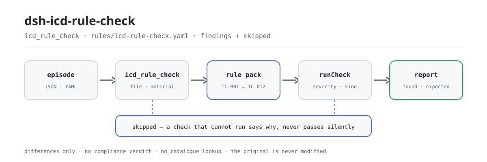

<div align="center">

<picture>
  <source media="(prefers-color-scheme: dark)" srcset="docs/assets/dsh-icd-rule-check-flow-dark.svg">
  
</picture>

# dsh-icd-rule-check

**Verifique la forma ICD-10 e ICD-9-CM-3, los duplicados, el emparejamiento daga/asterisco y la completitud de campos de un episodio codificado — y reciba una lista de qué es inconsistente, dónde y qué corregir.**

Un verificador de DeepSeek Harness para codificadores médicos y control de calidad: el paquete de reglas cita textualmente sus cláusulas públicas, informa solo diferencias literales frente a las cláusulas citadas, y nunca decide cumplimiento, no atribuye responsabilidad, no busca códigos en un catálogo ni toca su original.

[Instalar](#instalación-en-tres-pasos) · [Configuración](#configuración) · [FAQ](#faq) · [简体中文](README.md) · [English](README.en.md) · [Español](README.es.md) · [Português](README.pt.md) · [हिन्दी](README.hi.md)

[](LICENSE)
[](#compatibilidad)
[](https://www.npmjs.com/package/dsh-icd-rule-check)
[](https://github.com/PerryLink/dsh-icd-rule-check/actions/workflows/ci.yml)
[](#compatibilidad)

[](https://github.com/PerryLink/dsh-icd-rule-check/stargazers)
[](https://www.npmjs.com/package/dsh-icd-rule-check)
[](https://dshfind.com/plugins/PerryLink/dsh-icd-rule-check?ref=badge)
[](https://securityscorecards.dev/viewer/?uri=github.com/PerryLink/dsh-icd-rule-check)
[](https://dsh.market/)
[](https://gitee.com/perrylink/dsh-icd-rule-check)

```sh
dsh plugin --profile <name> add dsh-icd-rule-check
```

</div>

<sub>Plugin de la comunidad, no afiliado a DeepSeek. Repositorio canónico: <https://github.com/PerryLink/dsh-icd-rule-check> (Gitee es un espejo).</sub>

## Qué es

`dsh-icd-rule-check` lee un episodio de hospitalización codificado —el diagnóstico principal, los otros diagnósticos, el procedimiento principal, los otros procedimientos y los códigos de circunstancia de ingreso— y comprueba la estructura y las referencias internas de ese mismo episodio: que cada código de diagnóstico tenga forma ICD-10 y cada código de procedimiento forma ICD-9-CM-3 (los marcadores † / * se retiran antes de la comprobación de forma), que el mismo código de diagnóstico no se liste dos veces, que un código de asterisco tenga su código de daga pareja en el mismo episodio, que haya un diagnóstico principal y que estén rellenos los campos que cada comprobación necesita. Usted entrega el material original (JSON o YAML; Excel puede convertirse antes a JSON/YAML, en el chat si la plataforma lo permite) y recibe una lista de diferencias. No decide cumplimiento, no atribuye responsabilidad, no sustituye al revisor, no busca códigos en un catálogo y nunca modifica el original.

## Instalación en tres pasos

1. **Instale**:

   ```sh
   dsh plugin --profile <name> add dsh-icd-rule-check
   ```

   También puede buscar «Medical Record QC Suite» en WorkBuddy / Coze (el conjunto completo; esta comprobación es una parte; disponibilidad según catálogo).

2. **Configuración mínima** (funciona tal cual):

   ```yaml
   - insert:
       - id: dsh-icd-rule-check
         name: dsh-icd-rule-check
   ```

   Todos los parámetros ajustables viven en el esquema Schemastery de `src/config.ts` y los valores por defecto están listos para producción; los umbrales por regla están en el paquete de reglas bajo `rules/`.

3. **Verifique que se monta**:

   ```sh
   dsh --profile <name> --dump-config | grep 'dsh-icd-rule-check'
   ```

   Ejecute antes `pnpm run build` para generar `lib/` y luego el ejemplo incluido (alrededor de un minuto):

   ```sh
   node samples/quickstart/run.mjs --check
   ```

   La entrada del ejemplo está en `samples/quickstart/input/`, la salida esperada en `samples/quickstart/expected/result.json` y la captura de ejecución en `docs/assets/quickstart.png`.

**Desinstalar**: `dsh plugin --profile <name> remove dsh-icd-rule-check` (o elimine la fila del patch de perfil).

## Capacidades clave

El plugin registra la herramienta `icd_rule_check`: lee un episodio codificado (diagnósticos, procedimientos y circunstancia de ingreso), aplica un paquete de reglas versionado y devuelve un informe estructurado.

- **El paquete de reglas es dato, no código** — cada comprobación vive en `rules/icd-rule-check.yaml`, así que cambiar el conjunto de reglas no toca TypeScript; el paquete se valida al cargar, no se confía en él.
- **La gravedad sigue a la evidencia** — una regla basada en un principio general (`derived-from-principle`) se limita a `warn`; un umbral institucional (`institutional-configuration`) se limita a `info`; ninguna puede declararse `error` (hay un test que lo afirma).
- **Una lista vacía nunca significa «no hay nada mal»** — toda comprobación que no pudo ejecutarse se declara en `skipped` con su motivo; una regla cuya tabla `pairs` o `correspondence` no está configurada se declara en `skipped` en lugar de pasar en silencio.
- **Sin adjudicación** — el informe solo enumera diferencias y nunca se pronuncia sobre cumplimiento, responsabilidad o corrección; un guardián de redacción obliga a que el informe lleve siempre el descargo de responsabilidad.
- **Las citas deben ser literales** — cada regla lleva documento, número, cláusula en la numeración propia de la fuente, extracto literal y URL de origen; el cargador rechaza un extracto de menos de ocho caracteres, y una regla basada solo en un principio general o en configuración local nunca puede marcarse como `error`.
- **Sin consulta de catálogo** — comprueba la forma del código y las relaciones internas del registro, no si un código existe en su catálogo: eso exige una tabla licenciada cuya versión coincida con la del codificador, y una versión distinta solo produce conclusiones falsas con seguridad.

```text
episodio codificado (JSON · YAML) ──icd_rule_check──▶ paquete IC-001…IC-012 ──▶ informe (findings + skipped)
        ▲                                                                              │
        └────────────────────────── el original nunca se modifica ─────────────────────┘
```

### Las reglas de un vistazo

| Regla | Comprobación | Gravedad | Tipo de base |
|---|---|---|---|
| `IC-001` | todo código de diagnóstico tiene forma ICD-10 (con † / * retirados antes) | error | directa |
| `IC-002` | el mismo código de diagnóstico no se lista dos veces | warn | principio |
| `IC-003` | un código de asterisco tiene su código de daga en el mismo episodio | error | directa |
| `IC-004` | un diagnóstico aún usa la forma asterisco (*) (interruptor, apagado por defecto) | info | institucional |
| `IC-005` | el procedimiento principal se agrupa con el diagnóstico principal (tabla, apagado por defecto) | warn | directa |
| `IC-006` | un diagnóstico marcado «no presente al ingreso» no es el diagnóstico principal | warn | principio |
| `IC-007` | todo código de procedimiento tiene forma ICD-9-CM-3 | error | directa |
| `IC-008` | el motivo de consulta y los nombres de diagnóstico comparten un fragmento literal | info | principio |
| `IC-009` | hay un diagnóstico principal | error | directa |
| `IC-010` | los diagnósticos llevan nombre, no solo código (interruptor, apagado por defecto) | info | institucional |
| `IC-011` | una complicación T80-T88 como diagnóstico principal lleva un diagnóstico adicional | error | directa |
| `IC-012` | un síntoma del capítulo XVIII de la CIE-10 no es el diagnóstico principal cuando existe un diagnóstico definido | warn | principio |

### Ejemplos

Estos son los puntos de entrada reales del plugin; instálelo una vez y llame a uno.

**Salida detallada** — herramienta `icd_rule_check`, entrada:

```json
{"principalDiagnosis":{"code":"急性心肌梗死","name":"急性心肌梗死"},"otherDiagnoses":[{"code":"I10","name":"高血压"}],"principalProcedure":{"code":"36.0600","name":"冠状动脉支架植入术"}}
```

Salida:

```json
{
  "id": "dsh-icd-rule-check.IC-001.5a91e9d3",
  "ruleId": "IC-001",
  "severity": "error",
  "locator": {
    "column": "主要诊断",
    "cell": "急性心肌梗死"
  },
  "found": "诊断编码「急性心肌梗死」不符合 ICD-10 形式",
  "expected": "疾病诊断编码应当统一使用 ICD-10，形式为 ^[A-Z][0-9]{2}(\\.[0-9A-Z]{1,4})?$"
}
```

*Observed from `dsh-icd-rule-check/tests/fixtures/IC-001/IC-001-unsafe.json`*

### Qué responde

| Usted pregunta | Qué responde |
|---|---|
| La exportación guarda el código de diagnóstico como `A18.1†`. ¿La daga hará que salte la comprobación de forma? | No. `IC-001` retira los marcadores de daga y asterisco († / *) antes de examinar el código, así que el marcador por sí solo nunca produce una diferencia. Solo comprueba la forma del código: un código bien formado que su catálogo no contenga realmente pasa igualmente, porque verificarlo exige un catálogo licenciado de la misma versión que usa el codificador. |
| El campo del diagnóstico principal está vacío. ¿Qué se informa? | `IC-009` informa de que el registro no lleva diagnóstico principal e indica que hay que rellenarlo. Su límite: comprueba solo que el campo esté relleno, no que el diagnóstico elegido como principal sea el correcto; esa elección es del codificador y la regla no la hace. |
| Hay un código de asterisco en la lista y ningún código de daga que le corresponda. | `IC-003` informa del código de asterisco cuando el código de daga que le asigna la tabla de emparejamiento no aparece en el mismo episodio. Es la determinación más mecánica del paquete y necesita su propia tabla en `pairs`; con `pairs` vacío la regla informa de que no pudo ejecutarse en lugar de pasar en silencio. Su límite es el emparejamiento mismo: el paquete no adopta la lectura del ámbito chino del historial clínico según la cual un código de asterisco no puede ser el diagnóstico principal. |
| El mismo código de diagnóstico aparece listado dos veces. | `IC-002` informa del código repetido y lo trata como el mismo diagnóstico listado dos veces. Está limitada a `warn`: no se encontró ninguna cláusula que prohíba la repetición con esas palabras, así que su base es un principio y señala la fila para revisión en lugar de bloquear. |
| El diagnóstico principal es una complicación de la serie T82 y no hay ningún otro diagnóstico. | `IC-011` informa de esa fila. Con un diagnóstico principal en la serie T80-T88 solo pregunta si existe algún otro diagnóstico además del principal: la cláusula exige un código adicional que describa la complicación, pero no dice cuál, así que la regla no lo elige; eso corresponde al codificador y al catálogo en uso. |
| `IC-005` nunca informa de nada en nuestra exportación, ¿significa que el procedimiento principal concuerda con el diagnóstico principal? | No. `IC-005` se distribuye con su tabla `correspondence` vacía, de modo que se declara en `skipped` con el motivo de que la tabla no está configurada; una lista de diferencias vacía ahí no es un aprobado. Rellene `correspondence` con sus propias agrupaciones diagnóstico→procedimiento —una lista `procedures` vacía significa que ese grupo no debe llevar procedimiento principal— y la regla empieza a comparar. |

## Configuración

Todos los parámetros ajustables viven en el esquema Schemastery de `src/config.ts`, por lo que se cambian desde `cordis.yml` sin tocar el código; los umbrales por regla están en el paquete de reglas bajo `rules/`. Estas cinco claves son toda la superficie de configuración; los parámetros por regla vienen después.

| Clave | Tipo | Predeterminado | Descripción |
|---|---|---|---|
| `rulesFile` | string | `rules/icd-rule-check.yaml` | Ruta del paquete de reglas, relativa a la raíz del paquete; apúntela a otro sitio para cambiar de versión |
| `disabledRules` | string[] | `[]` | Ids de reglas que se dejan de ejecutar; cada una aparece en `skipped` |
| `onlyRules` | string[] | `[]` | Ejecutar solo estas reglas; vacío ejecuta todas |
| `skipNotes` | string | `""` | Nota añadida a cada motivo de `skipped`, p. ej. sus reglas institucionales |
| `timeoutMs` | number | `120000` | Presupuesto de tiempo de espera cooperativo de la herramienta (ms) |

Parámetros por regla que conviene conocer:

- `IC-003` `pairs` — su tabla daga↔asterisco, como `[{ dagger, asterisk }]`. Vacía significa que la comprobación no puede ejecutarse y lo dice.
- `IC-005` `correspondence` — sus agrupaciones diagnóstico→procedimiento, como `[{ diagnosis: [I21], procedures: [36.06, 36.07] }]`. Una lista `procedures` vacía significa «este grupo no debe llevar procedimiento principal».
- `IC-004` `flagAsteriskUse` e `IC-010` `requireNames` — apagados hasta que los active para su catálogo y reglas de presentación.
- `IC-006` `flagCode` — el código de circunstancia de ingreso que significa «no presente al ingreso». Por defecto `4`.

## FAQ

<details>
<summary>¿Mi material se modifica o se sube a algún sitio?</summary>

No. La herramienta solo lee el material JSON/YAML que usted entrega y **nunca modifica el original**; el plugin es ESM puro, sin código nativo, **sin peticiones de red y sin llamadas al modelo** (ver «Compatibilidad»), así que el material no sale de su máquina. La entrada es `file` (una ruta absoluta) o `material` (texto en línea).

</details>

<details>
<summary>Con <code>pairs</code> o <code>correspondence</code> sin configurar, ¿pasa en silencio?</summary>

No. El `pairs` de `IC-003` y el `correspondence` de `IC-005` salen vacíos, y una regla sin configurar se declara en `skipped` con su motivo — una lista de diferencias vacía nunca se lee como «no hay nada mal». Rellene las tablas con los mapeos de su catálogo y esas comprobaciones empiezan a comparar.

</details>

<details>
<summary>Un código que sé válido se informa como mal formado. ¿Qué hago?</summary>

`IC-001` comprueba solo la forma. Si su catálogo usa una escritura fuera de `^[A-Z][0-9]{2}(\.[0-9A-Z]{1,4})?$`, cambie ese patrón en el paquete de reglas; la regla nunca comprueba si un código existe en un catálogo, así que un código bien formado siempre pasa.

</details>

<details>
<summary>El plugin se instala pero la herramienta no aparece. ¿Qué reviso?</summary>

Compruebe que `main` resuelve a `lib/index.mjs` y que `pnpm run build` lo generó; un `main` incorrecto hace que el cargador omita la entrada en silencio.

</details>

<details>
<summary><code>dsh plugin add</code> rechaza el paquete como incompatible. ¿Qué opciones tengo?</summary>

El rango de peers cubre `0.1.x` y `0.2.x`; si su runtime queda fuera, conceda una exención explícita: `dsh plugin --profile <name> allow-version dsh-icd-rule-check@0.1.0 --dsh-version <runtime> --accept-risk`. En la práctica, la compatibilidad de peers la aplica el runtime al instalar.

</details>

## Normas que sigue

| Documento | Número | Reglas que lo citan |
|---|---|---|
| Especificación de calidad para el llenado de la hoja de ingreso hospitalario (provisional) | Guowei Bianyi Fa [2016] No. 24 | IC-001, IC-002, IC-004, IC-005, IC-007, IC-008, IC-009, IC-010, IC-012 |
| Clasificación internacional de enfermedades y problemas de salud relacionados, 10.ª revisión, Volumen 2 — manual de instrucciones | WHO ICD-10 Volume 2 (2.ª ed., 2004, ISBN 92 4 154653 0) | IC-003 |
| Clasificación y códigos de enfermedades | GB/T 14396-2016 | IC-003 |
| Versión clínica nacional 2.0 de la clasificación y códigos de enfermedades | Guowei Bianyi Han [2019] No. 371, Anexo 1 | IC-003 |
| Especificación para el llenado de la lista de liquidación del fondo de seguro médico (ensayo) | Yibaoban Fa [2020] No. 20 | IC-005, IC-011, IC-006, IC-010, IC-012 |
| Indicadores de gestión y control de calidad de los datos de la hoja de ingreso hospitalario (edición 2016) | Guowei Bianyi Fa [2016] No. 24 | IC-009 |

Títulos originales de los documentos citados:

```text
《住院病案首页数据填写质量规范（暂行）》 国卫办医发〔2016〕24号
《疾病和有关健康问题的国际统计分类》第十次修订本 第二卷 指导手册 WHO ICD-10 Volume 2
《疾病分类与代码》 GB/T 14396-2016
《疾病分类与代码国家临床版 2.0》 国卫办医函〔2019〕371号 附件1
《医疗保障基金结算清单填写规范（试行）》 医保办发〔2020〕20号
《住院病案首页数据质量管理与控制指标（2016版）》 国卫办医发〔2016〕24号
```

**Límite:** este plugin realiza comprobaciones **estructurales** sobre los códigos de un episodio de hospitalización —forma del código, duplicados, emparejamiento daga/asterisco, completitud de campos— e informa diferencias literales frente a las cláusulas citadas. No es `dsh-medrec-qc` (que revisa la hoja de ingreso completa, incluidas sus contradicciones lógicas), no es un catálogo de códigos ni un codificador. Nunca busca un código: una consulta de catálogo exige una tabla licenciada cuya versión coincida con la del codificador, y una versión distinta produce conclusiones falsas con seguridad.

> ### ⚠️ Dos cosas que este plugin deliberadamente **no** hace, y por qué
>
> **No implementa una regla de código combinado ni decide por el codificador si el procedimiento principal corresponde al diagnóstico principal.** La tarea a partir de la cual se construyó este plugin señaló la codificación combinada como riesgo de ruta crítica: las reglas están dispersas entre guías de usuario de la CIE, el manual de la versión clínica y material de formación de codificadores, y **no se encontró ninguna cláusula nacional citable públicamente**. Este paquete de reglas se basa en la regla de que una entrada cuya base no puede citarse no entra, así que no inventa un número de cláusula y convierte esa comprobación de consistencia en la comparación parametrizada de `IC-005` — su base se ha ascendido a `direct` (Guowei Bianyi Fa [2016] No. 24, art. 11(2) y art. 22; Yibaoban Fa [2020] No. 20, anexo 1, nota 1, punto 4), pero la **tabla diagnóstico→procedimiento no se incluye**: `correspondence` sale vacía, la comparación empieza cuando la rellene para su catálogo y, hasta entonces, la regla se declara en `skipped`.
>
> **No incluye una tabla de emparejamiento daga/asterisco.** El sistema †/* proviene del manual de instrucciones del Volumen 2 de la CIE-10 († marca una afección clasificada aquí, * una manifestación clasificada en otro lugar), y el requisito de emparejamiento es una consecuencia estructural de ese sistema. `IC-003` cita el original inglés de §3.1.3 («For coding, the asterisk code must never be used alone.») y las definiciones de símbolos de GB/T 14396-2016, así que su base es `direct` y su gravedad `error`; lo que no incluye son los **datos de emparejamiento**: la tabla `pairs` sale vacía porque su versión debe coincidir con el catálogo del codificador, y la regla se declara en `skipped` hasta que la rellene.

## Formato del material

La herramienta acepta JSON o YAML. Los campos son opcionales en la capa de lectura y los valida el motor, de modo que una exportación parcial produce hallazgos sobre lo que falta en lugar de un fallo.

```yaml
principalDiagnosis: { code: "I21.900", name: 急性心肌梗死 }
otherDiagnoses:
  - { code: "I10", name: 高血压 }
principalProcedure: { code: "36.0600", name: 冠状动脉支架植入术 }
otherProcedures: []
chiefComplaint: 突发心肌梗死样胸痛 3 小时
admissionCondition:
  "I21.900": "1"     # alimenta IC-006
```

Una entrada también puede ser una cadena de código sola (`principalDiagnosis: I21.900`), y un diagnóstico o procedimiento puede llevar los marcadores de la CIE-10 (`A18.1†`, `N51.0*`): se retiran antes de la comprobación de forma, así que un marcador nunca dispara `IC-001`.

## Fuentes de las reglas

Los datos de las reglas están en `rules/icd-rule-check.yaml`, separados del código. Cada regla lleva documento, número, cláusula en la numeración propia de la fuente, extracto literal y URL de origen. El cargador impone que el extracto sea una cita real de al menos ocho caracteres y que una comprobación basada solo en un principio general o en una política local nunca se declare `error`.

Las cláusulas citadas provienen de la Especificación de calidad para el llenado de la hoja de ingreso hospitalario (provisional) y de los indicadores de control de calidad de 2016 (Guowei Bianyi Fa [2016] No. 24), y de la Especificación para el llenado de la lista de liquidación del fondo de seguro médico (ensayo) (Yibaoban Fa [2020] No. 20). Dos hallazgos de la investigación dieron forma al paquete y quedan registrados en él:

1. **No se encontró ninguna cláusula citable para la codificación combinada**, así que aquí no existe una regla de código combinado. El resultado honesto de esa investigación es un gancho parametrizado vacío por defecto, no una regla con un número de cláusula inventado.
2. **La posición de la forma asterisco depende de la versión del catálogo.** La versión clínica nacional y la versión del seguro la tratan de forma distinta, por lo que `IC-004` es un interruptor y no una regla.

El registro completo de verificación de cláusulas (incluidas las fuentes comprobadas y luego descartadas) está en `rules/evidence/`.

## Compatibilidad

| Superficie | Estado |
|---|---|
| Harness | Rango de peers `>=0.1.2-rc.1 <0.2.0 \|\| >=0.2.0-0 <0.3.0` — verificado para aceptar tanto `0.2.0-rc.2` como `0.2.1-rc.2`. **`engines.dsh` se declara como `>=0.2.1-0 <0.3.0`** y el host lo aplica desde 0.2.1 |
| Node | `^22.19.0 \|\| >=24.0.0` |
| Plataformas | Todas (ESM puro; sin código nativo, sin red, sin llamada al modelo) |
| Modo de herramienta | Funciona en `native` y `ptc`; para un lote de registros use `ptc`, el coste del esquema se paga una vez |

## Solución de problemas

- **`IC-003` o `IC-005` se declaran en skipped.** La tabla que necesitan está vacía. Rellene `pairs` o `correspondence` con la versión que usan sus codificadores.
- **Un código que sabe válido se informa como mal formado.** `IC-001` solo comprueba la forma; si su catálogo usa una escritura fuera de `^[A-Z][0-9]{2}(\.[0-9A-Z]{1,4})?$`, cambie el patrón en el paquete de reglas.
- **`IC-008` salta en un registro clínicamente sensato.** Compara el motivo de consulta con los **nombres** de diagnóstico por fragmento literal, lo que es una operación de cadenas, no un juicio de codificación. Añada el nombre que usa o desactive la regla.
- **El plugin se instala pero la herramienta no aparece.** Compruebe que `main` resuelve a `lib/index.mjs` y que `pnpm run build` lo generó; un `main` incorrecto hace que el cargador omita la entrada en silencio.
- **`dsh plugin add` rechaza el paquete por incompatibilidad.** El rango de peers cubre `0.1.x` y `0.2.x`; si su runtime queda fuera, conceda una exención explícita: `dsh plugin --profile <name> allow-version dsh-icd-rule-check@0.1.0 --dsh-version <runtime> --accept-risk`
- **`check` informa `manifest-peers` como fallo.** El verificador estático compara con un rango de peers codificado que es anterior a la línea 0.2; el runtime aplica la compatibilidad al instalar, así que el rango declarado es el correcto. Es un problema conocido de `dsh-plugin-dev`.

## Ecosistema y calidad

- [Espejo en Gitee](https://gitee.com/perrylink/dsh-icd-rule-check) (espejo sincronizado; GitHub es el canónico)
- [Página de dshfind](https://dshfind.com/plugins/PerryLink/dsh-icd-rule-check) (instalaciones y ranking)
- [Informe OpenSSF Scorecard](https://securityscorecards.dev/viewer/?uri=github.com/PerryLink/dsh-icd-rule-check) (impulsado por [.github/workflows/scorecard.yml](.github/workflows/scorecard.yml))
- [DSH Market](https://dsh.market/) (listado)
- [Base de conocimiento — elija un verificador por material](https://perrylink.github.io/zh/checkers/choose/) (la familia completa: 62 verificadores + plugins generales)

## Desarrollo

```sh
pnpm install
pnpm run typecheck   # tsc --noEmit
pnpm test            # vitest, fixtures conformes/violantes emparejados por regla (tests/fixtures/<RULE>/)
pnpm run build       # tsdown -> lib/index.mjs + lib/index.d.mts
pnpm run verify:self-contained
pnpm run check:lockfile
pnpm run check:readmes   # consistencia de los README en cinco idiomas
pnpm run check:citations # verificación de las citas de las reglas
node ../scripts/sync-shared.mjs dsh-icd-rule-check   # refresca src/shared desde ../_shared
```

El paquete de reglas es dato, no código: sustituir `rules/*.yaml` cambia el conjunto de reglas sin tocar TypeScript, y el paquete se valida al cargar en lugar de confiarse. La puerta de publicación ejecuta typecheck, tests, build, la comprobación de autocontención, lockfile, README en cinco idiomas y verificación de citas; `prepublishOnly` la vuelve a ejecutar.

| Ruta | Función |
|---|---|
| `src/index.ts` | contrato de plugin de función (`name`/`inject`/`Config`/`apply`); registra `icd_rule_check` y resuelve el paquete de reglas incluido |
| `src/config.ts` | esquema Schemastery; todo lo ajustable vive aquí, nada codificado |
| `src/check.ts` | núcleo puro `(input, ruleset, options) => Report`: sin contexto de plugin, sin E/S, sin reloj, sin modelo |
| `src/parse.ts` | lector del material canónico JSON/YAML |
| `src/view.ts` | proyección del informe para el modelo; `output.schema` en `src/index.ts` la refleja |
| `src/shared/` | kit compartido (carga de reglas, forma del informe, subconjunto YAML, guardián de redacción, ayudas de tabla), copiado para que el paquete sea autocontenido |
| `rules/icd-rule-check.yaml` | paquete de reglas, 12 reglas |
| `rules/evidence/` | registro de verificación de cada cita |
| `tests/fixtures/<RULE>/` | fixtures conformes/violantes emparejados por regla |

Las imágenes del README se generan programáticamente con [`scripts/gen-readme-assets.py`](scripts/gen-readme-assets.py) (Python + Pillow) y se pueden volver a ejecutar; este plugin no tiene UI, así que el hero es un diagrama de flujo SVG dibujado a mano (variantes clara y oscura, solo tokens de la superficie de comandos).

Topics: `dsh`, `dsh-plugin`, `deepseek-harness`, `deepseek`, `cordis`, `icd`, `rule`

## Familia y agradecimientos

Este proyecto forma parte de la familia de plugins de DeepSeek Harness de [PerryLink](https://github.com/PerryLink) (todos Apache-2.0). Si le resulta útil, **una estrella ayuda a que la siguiente persona lo encuentre** — nada queda bloqueado por ello.

- [@PerryLink](https://github.com/PerryLink) — creador y mantenedor: la herramienta `icd_rule_check`, el paquete de reglas con citas literales, el registro de verificación de cláusulas y la documentación en cinco idiomas.

<details>
<summary>Expandir todos los plugins</summary>

| Plugin | Estado |
|---|---|
| **[dsh-aqua-input-check](https://github.com/PerryLink/dsh-aqua-input-check)** |  |
| **[dsh-archive-check](https://github.com/PerryLink/dsh-archive-check)** |  |
| **[dsh-auto-review](https://github.com/PerryLink/dsh-auto-review)** |  |
| **[dsh-autotier](https://github.com/PerryLink/dsh-autotier)** | 🧊 CONGELADO — ver el README del repo |
| **[dsh-bid-ca-precheck](https://github.com/PerryLink/dsh-bid-ca-precheck)** |  |
| **[dsh-bid-qual-check](https://github.com/PerryLink/dsh-bid-qual-check)** |  |
| **[dsh-cert-mcp](https://github.com/PerryLink/dsh-cert-mcp)** | 🧊 CONGELADO — ver el README del repo |
| **[dsh-checkpoint-rewind](https://github.com/PerryLink/dsh-checkpoint-rewind)** |  |
| **[dsh-click](https://github.com/PerryLink/dsh-click)** |  |
| **[dsh-composer-history](https://github.com/PerryLink/dsh-composer-history)** |  |
| **[dsh-contract-stance](https://github.com/PerryLink/dsh-contract-stance)** |  |
| **[dsh-customs-doc-check](https://github.com/PerryLink/dsh-customs-doc-check)** |  |
| **[dsh-data-quality](https://github.com/PerryLink/dsh-data-quality)** |  |
| **[dsh-demurrage-ledger](https://github.com/PerryLink/dsh-demurrage-ledger)** |  |
| **[dsh-doublecheck](https://github.com/PerryLink/dsh-doublecheck)** |  |
| **[dsh-drill-script-check](https://github.com/PerryLink/dsh-drill-script-check)** |  |
| **[dsh-eia-guide-check](https://github.com/PerryLink/dsh-eia-guide-check)** |  |
| **[dsh-emergency-plan](https://github.com/PerryLink/dsh-emergency-plan)** |  |
| **[dsh-essay-rubric-check](https://github.com/PerryLink/dsh-essay-rubric-check)** |  |
| **[dsh-evidence-check](https://github.com/PerryLink/dsh-evidence-check)** |  |
| **[dsh-export-ctl-check](https://github.com/PerryLink/dsh-export-ctl-check)** |  |
| **[dsh-fast](https://github.com/PerryLink/dsh-fast)** |  |
| **[dsh-fmea-table-check](https://github.com/PerryLink/dsh-fmea-table-check)** |  |
| **[dsh-forecast-penalty](https://github.com/PerryLink/dsh-forecast-penalty)** |  |
| **[dsh-fund-research](https://github.com/PerryLink/dsh-fund-research)** |  |
| **[dsh-github](https://github.com/PerryLink/dsh-github)** |  |
| **[dsh-gongwen-flow-check](https://github.com/PerryLink/dsh-gongwen-flow-check)** |  |
| **[dsh-gongwen-word-check](https://github.com/PerryLink/dsh-gongwen-word-check)** |  |
| **[dsh-guard-plan-qc](https://github.com/PerryLink/dsh-guard-plan-qc)** |  |
| **[dsh-hazchem-check](https://github.com/PerryLink/dsh-hazchem-check)** |  |
| **[dsh-hazplan-check](https://github.com/PerryLink/dsh-hazplan-check)** |  |
| **[dsh-hidden-risk-map](https://github.com/PerryLink/dsh-hidden-risk-map)** |  |
| **[dsh-hs-classify](https://github.com/PerryLink/dsh-hs-classify)** |  |
| **[dsh-icd-rule-check](https://github.com/PerryLink/dsh-icd-rule-check)** |  |
| **[dsh-industry-research](https://github.com/PerryLink/dsh-industry-research)** |  |
| **[dsh-lawcite-adapter](https://github.com/PerryLink/dsh-lawcite-adapter)** |  |
| **[dsh-laya](https://github.com/PerryLink/dsh-laya)** |  |
| **[dsh-lc-doc-check](https://github.com/PerryLink/dsh-lc-doc-check)** |  |
| **[dsh-learning-gap-check](https://github.com/PerryLink/dsh-learning-gap-check)** |  |
| **[dsh-library](https://github.com/PerryLink/dsh-library)** |  |
| **[dsh-local-ai](https://github.com/PerryLink/dsh-local-ai)** |  |
| **[dsh-lsp-actions](https://github.com/PerryLink/dsh-lsp-actions)** |  |
| **[dsh-mask](https://github.com/PerryLink/dsh-mask)** |  |
| **[dsh-mcp-panel](https://github.com/PerryLink/dsh-mcp-panel)** |  |
| **[dsh-medrec-qc](https://github.com/PerryLink/dsh-medrec-qc)** |  |
| **[dsh-memento](https://github.com/PerryLink/dsh-memento)** |  |
| **[dsh-nsfc-form-check](https://github.com/PerryLink/dsh-nsfc-form-check)** |  |
| **[dsh-nurse-record-check](https://github.com/PerryLink/dsh-nurse-record-check)** |  |
| **[dsh-observe](https://github.com/PerryLink/dsh-observe)** |  |
| **[dsh-origin-rvc-check](https://github.com/PerryLink/dsh-origin-rvc-check)** |  |
| **[dsh-ota-review-check](https://github.com/PerryLink/dsh-ota-review-check)** |  |
| **[dsh-output-styles](https://github.com/PerryLink/dsh-output-styles)** |  |
| **[dsh-paper-doc-adapter](https://github.com/PerryLink/dsh-paper-doc-adapter)** |  |
| **[dsh-permission-rules](https://github.com/PerryLink/dsh-permission-rules)** |  |
| **[dsh-permit-report-check](https://github.com/PerryLink/dsh-permit-report-check)** |  |
| **[dsh-pipeline-check](https://github.com/PerryLink/dsh-pipeline-check)** |  |
| **[dsh-pleading-draft](https://github.com/PerryLink/dsh-pleading-draft)** |  |
| **[dsh-plugin-doctor](https://github.com/PerryLink/dsh-plugin-doctor)** | 🚫 RETIRADO (repo archivado) |
| **[dsh-plugin-guide](https://github.com/PerryLink/dsh-plugin-guide)** |  |
| **[dsh-plugin-kit](https://github.com/PerryLink/dsh-plugin-kit)** | 🚫 RETIRADO (repo archivado) |
| **[dsh-plugin-upgrade](https://github.com/PerryLink/dsh-plugin-upgrade)** | 🚫 RETIRADO (repo archivado) |
| **[dsh-policy-brief-draft](https://github.com/PerryLink/dsh-policy-brief-draft)** |  |
| **[dsh-power-loss-split](https://github.com/PerryLink/dsh-power-loss-split)** |  |
| **[dsh-power-ticket-check](https://github.com/PerryLink/dsh-power-ticket-check)** |  |
| **[dsh-ppap-check](https://github.com/PerryLink/dsh-ppap-check)** |  |
| **[dsh-protest-deadline](https://github.com/PerryLink/dsh-protest-deadline)** |  |
| **[dsh-railway-window](https://github.com/PerryLink/dsh-railway-window)** |  |
| **[dsh-repair-order-qc](https://github.com/PerryLink/dsh-repair-order-qc)** |  |
| **[dsh-research-report](https://github.com/PerryLink/dsh-research-report)** |  |
| **[dsh-review-reply-check](https://github.com/PerryLink/dsh-review-reply-check)** |  |
| **[dsh-rulefile-check](https://github.com/PerryLink/dsh-rulefile-check)** |  |
| **[dsh-safety-brief-check](https://github.com/PerryLink/dsh-safety-brief-check)** |  |
| **[dsh-score](https://github.com/PerryLink/dsh-score)** |  |
| **[dsh-session-sync](https://github.com/PerryLink/dsh-session-sync)** |  |
| **[dsh-site-log-check](https://github.com/PerryLink/dsh-site-log-check)** |  |
| **[dsh-skill-pack-security](https://github.com/PerryLink/dsh-skill-pack-security)** |  |
| **[dsh-soe-decision-check](https://github.com/PerryLink/dsh-soe-decision-check)** |  |
| **[dsh-soilwater-check](https://github.com/PerryLink/dsh-soilwater-check)** |  |
| **[dsh-sop-sync-check](https://github.com/PerryLink/dsh-sop-sync-check)** |  |
| **[dsh-spc-gbt-adapter](https://github.com/PerryLink/dsh-spc-gbt-adapter)** |  |
| **[dsh-talk](https://github.com/PerryLink/dsh-talk)** |  |
| **[dsh-tender-extract](https://github.com/PerryLink/dsh-tender-extract)** |  |
| **[dsh-tender-matrix](https://github.com/PerryLink/dsh-tender-matrix)** |  |
| **[dsh-test-drive](https://github.com/PerryLink/dsh-test-drive)** |  |
| **[dsh-ticktick](https://github.com/PerryLink/dsh-ticktick)** | 🚫 RETIRADO (repo archivado) |
| **[dsh-translate](https://github.com/PerryLink/dsh-translate)** |  |
| **[dsh-warranty-calc](https://github.com/PerryLink/dsh-warranty-calc)** |  |
| **[dsh-budget](https://github.com/PerryLink/dsh-budget)** | 🧊 CONGELADO — ver el README del repo |
| **[dsh-claude-move](https://github.com/PerryLink/dsh-claude-move)** | 🧊 CONGELADO — ver el README del repo |
| **[dsh-defend](https://github.com/PerryLink/dsh-defend)** | 🧊 CONGELADO — ver el README del repo |
| **[dsh-draw](https://github.com/PerryLink/dsh-draw)** | 🧊 CONGELADO — ver el README del repo |
| **[dsh-reach](https://github.com/PerryLink/dsh-reach)** | 🧊 CONGELADO — ver el README del repo |
| **[dsh-background-agents](https://github.com/PerryLink/dsh-background-agents)** | 🚫 RETIRADO (repo archivado) |
| **[dsh-session-pin](https://github.com/PerryLink/dsh-session-pin)** | 🚫 RETIRADO (repo archivado) |
| **[dsh-team-rooms](https://github.com/PerryLink/dsh-team-rooms)** | 🚫 RETIRADO (repo archivado) |

</details>

## Licencia

[LICENSE](LICENSE) (Apache License 2.0) © 2026 dsh-icd-rule-check contributors

<p align="center"><sub>Apache-2.0 · Plugin de la comunidad, no afiliado a DeepSeek.</sub></p>
