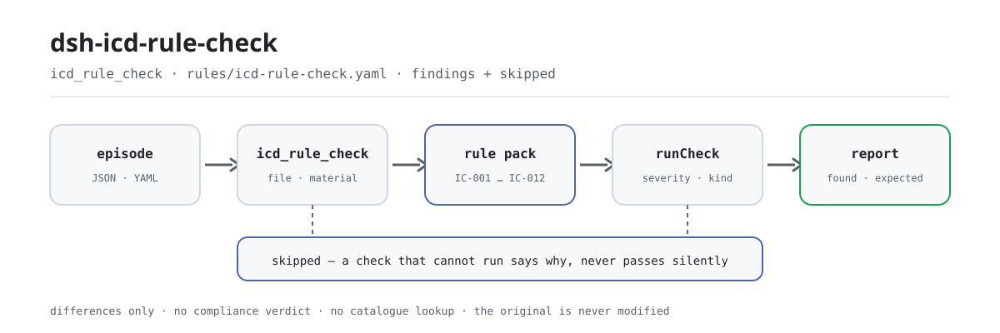

<div align="center">

<picture>
  <source media="(prefers-color-scheme: dark)" srcset="docs/assets/dsh-icd-rule-check-flow-dark.svg">
  
</picture>

# dsh-icd-rule-check

**एक कोडित इनपेशेंट प्रकरण के ICD-10 और ICD-9-CM-3 कूट-रूप, दोहराव, डैगर/एस्टरिस्क युग्मन और फ़ील्ड पूर्णता की जाँच करें — और पाएँ कि क्या असंगत है, कहाँ है और क्या सुधारना है।**

DeepSeek Harness के लिए मेडिकल कोडर और गुणवत्ता-नियंत्रण कर्मचारियों हेतु जाँच प्लगइन: नियम-पैक अपने सार्वजनिक खंडों को शब्दशः उद्धृत करता है, उद्धृत खंडों के सामने केवल शाब्दिक अंतर बताता है, और कभी अनुपालन का निर्णय नहीं देता, उत्तरदायित्व नहीं ठहराता, कूट-सूची में कूट नहीं खोजता और आपका मूल नहीं बदलता।

[इंस्टॉल](#तीन-चरणों-में-शुरुआत) · [कॉन्फ़िगरेशन](#कॉन्फ़िगरेशन) · [FAQ](#faq) · [简体中文](README.md) · [English](README.en.md) · [Español](README.es.md) · [Português](README.pt.md) · [हिन्दी](README.hi.md)

[](LICENSE)
[](#संगतता)
[](https://www.npmjs.com/package/dsh-icd-rule-check)
[](https://github.com/PerryLink/dsh-icd-rule-check/actions/workflows/ci.yml)
[](#संगतता)

[](https://github.com/PerryLink/dsh-icd-rule-check/stargazers)
[](https://www.npmjs.com/package/dsh-icd-rule-check)
[](https://dshfind.com/plugins/PerryLink/dsh-icd-rule-check?ref=badge)
[](https://securityscorecards.dev/viewer/?uri=github.com/PerryLink/dsh-icd-rule-check)
[](https://dsh.market/)
[](https://gitee.com/perrylink/dsh-icd-rule-check)

```sh
dsh plugin --profile <name> add dsh-icd-rule-check
```

</div>

<sub>सामुदायिक प्लगइन, DeepSeek से असंबद्ध। कैनोनिकल रिपॉज़िटरी: <https://github.com/PerryLink/dsh-icd-rule-check> (Gitee एक मिरर है)।</sub>

## यह क्या है

`dsh-icd-rule-check` एक कूटबद्ध इनपेशेंट प्रकरण पढ़ता है — मुख्य निदान, अन्य निदान, मुख्य शल्य-प्रक्रिया, अन्य शल्य-प्रक्रियाएँ और प्रवेश-स्थिति कूट — और उसी प्रकरण की संरचना तथा आंतरिक संबंधों की जाँच करता है: क्या प्रत्येक निदान कूट ICD-10 रूप में है और प्रत्येक शल्य-प्रक्रिया कूट ICD-9-CM-3 रूप में (रूप-जाँच से पहले † / * चिह्न हटा दिए जाते हैं), क्या वही निदान कूट दो बार सूचीबद्ध नहीं है, क्या किसी एस्टरिस्क कूट का उसका डैगर साथी उसी प्रकरण में मौजूद है, क्या मुख्य निदान भरा गया है, और प्रत्येक जाँच के लिए आवश्यक क्षेत्र भरे हैं या नहीं। आप मूल सामग्री देते हैं (JSON या YAML; Excel को पहले JSON/YAML में बदला जा सकता है, चैट में भी यदि प्लेटफ़ॉर्म समर्थन दे) और यह अंतरों की सूची लौटाता है। यह अनुपालन का निर्णय नहीं देता, उत्तरदायित्व नहीं ठहराता, समीक्षक का स्थान नहीं लेता, कूट-सूची में कूट नहीं खोजता और मूल कभी नहीं बदलता।

## तीन चरणों में शुरुआत

1. **इंस्टॉल करें**:

   ```sh
   dsh plugin --profile <name> add dsh-icd-rule-check
   ```

   WorkBuddy / Coze में «Medical Record QC Suite» भी खोज सकते हैं (पूरा सेट; यह जाँच उसका एक भाग है; उपलब्धता सूची के अनुसार)।

2. **न्यूनतम कॉन्फ़िग** (जैसा है वैसा ही चलता है):

   ```yaml
   - insert:
       - id: dsh-icd-rule-check
         name: dsh-icd-rule-check
   ```

   सभी समायोज्य पैरामीटर `src/config.ts` की Schemastery स्कीमा में हैं और डिफ़ॉल्ट उत्पादन-योग्य हैं; प्रति-नियम सीमाएँ `rules/` के नियम-पैक में हैं।

3. **जाँचें कि यह माउंट होता है**:

   ```sh
   dsh --profile <name> --dump-config | grep 'dsh-icd-rule-check'
   ```

   पहले `pnpm run build` चलाकर `lib/` बनाएँ, फिर साथ आया नमूना चलाएँ (लगभग एक मिनट):

   ```sh
   node samples/quickstart/run.mjs --check
   ```

   नमूना इनपुट `samples/quickstart/input/` में, अपेक्षित आउटपुट `samples/quickstart/expected/result.json` में और चलाने का स्क्रीनशॉट `docs/assets/quickstart.png` में है।

**अनइंस्टॉल**: `dsh plugin --profile <name> remove dsh-icd-rule-check` (या प्रोफ़ाइल पैच से वह पंक्ति हटाएँ)।

## मुख्य क्षमताएँ

प्लगइन `icd_rule_check` उपकरण पंजीकृत करता है: यह एक कोडित प्रकरण (निदान, शल्य-प्रक्रियाएँ और प्रवेश-स्थिति) पढ़ता है, संस्करण-बद्ध नियम-पैक लागू करता है और संरचित रिपोर्ट लौटाता है।

- **नियम-पैक डेटा है, कोड नहीं** — हर जाँच `rules/icd-rule-check.yaml` में है, इसलिए नियम-समुच्चय बदलने से TypeScript नहीं छूता; पैक लोड होते समय सत्यापित होता है, उस पर भरोसा नहीं किया जाता।
- **गंभीरता साक्ष्य के अनुसार** — सामान्य सिद्धांत पर आधारित नियम (`derived-from-principle`) `warn` तक सीमित है; संस्थागत सीमा (`institutional-configuration`) `info` तक सीमित है; किसी को भी `error` घोषित नहीं किया जा सकता (एक परीक्षण इसकी पुष्टि करता है)।
- **खाली सूची का अर्थ «कुछ भी गलत नहीं» कभी नहीं** — जो जाँच नहीं चल सकी वह अपना कारण `skipped` में बताती है; जिस नियम की `pairs` या `correspondence` सारणी सेट नहीं है वह चुपचाप पास होने के बजाय `skipped` में स्वयं को दर्ज करता है।
- **कोई निर्णय नहीं** — रिपोर्ट केवल अंतर सूचीबद्ध करती है और अनुपालन, उत्तरदायित्व या शुद्धता पर कभी निर्णय नहीं देती; एक शब्द-रक्षक सुनिश्चित करता है कि रिपोर्ट के साथ अस्वीकरण सदैव रहे।
- **उद्धरण शब्दशः होने चाहिए** — हर नियम में दस्तावेज़, उसका संख्यांक, स्रोत की अपनी क्रमांकन-प्रणाली के अनुसार धारा, शब्दशः उद्धरण और स्रोत URL होता है; लोडर आठ अक्षरों से छोटा उद्धरण अस्वीकार करता है, और केवल सामान्य सिद्धांत या स्थानीय कॉन्फ़िगरेशन पर आधारित नियम कभी `error` चिह्नित नहीं हो सकता।
- **कोई कूट-सूची खोज नहीं** — यह कूट का रूप और अभिलेख के भीतरी संबंध जाँचता है, यह नहीं कि कोई कूट आपकी सूची में मौजूद है: उसके लिए कोडर के समान संस्करण वाली अधिकृत सूची चाहिए, और भिन्न संस्करण केवल आत्मविश्वास से भरी गलत निष्कर्ष देता है।

```text
कोडित इनपेशेंट प्रकरण (JSON · YAML) ──icd_rule_check──▶ नियम-पैक IC-001…IC-012 ──▶ रिपोर्ट (findings + skipped)
        ▲                                                                                    │
        └────────────────────────────── मूल कभी नहीं बदलता ─────────────────────────────────┘
```

### एक नज़र में नियम

| नियम | जाँच | गंभीरता | आधार प्रकार |
|---|---|---|---|
| `IC-001` | प्रत्येक निदान कूट ICD-10 रूप में (पहले † / * हटाए जाते हैं) | error | प्रत्यक्ष |
| `IC-002` | वही निदान कूट दो बार सूचीबद्ध नहीं | warn | सिद्धांत |
| `IC-003` | एस्टरिस्क कूट का डैगर साथी उसी प्रकरण में मौजूद | error | प्रत्यक्ष |
| `IC-004` | निदान अब भी एस्टरिस्क (*) रूप में (स्विच, डिफ़ॉल्ट रूप से बंद) | info | संस्थागत |
| `IC-005` | मुख्य शल्य-प्रक्रिया मुख्य निदान के समूह में (सारणी, डिफ़ॉल्ट रूप से बंद) | warn | प्रत्यक्ष |
| `IC-006` | «प्रवेश पर अनुपस्थित» चिह्नित निदान मुख्य निदान नहीं | warn | सिद्धांत |
| `IC-007` | प्रत्येक शल्य-प्रक्रिया कूट ICD-9-CM-3 रूप में | error | प्रत्यक्ष |
| `IC-008` | मुख्य शिकायत और निदान नामों में शाब्दिक अंश साझा | info | सिद्धांत |
| `IC-009` | मुख्य निदान भरा गया है | error | प्रत्यक्ष |
| `IC-010` | निदान के साथ नाम भी, केवल कूट नहीं (स्विच, डिफ़ॉल्ट रूप से बंद) | info | संस्थागत |
| `IC-011` | मुख्य निदान T80-T88 जटिलता होने पर अतिरिक्त निदान | error | प्रत्यक्ष |
| `IC-012` | स्पष्ट निदान होने पर ICD-10 अध्याय XVIII का लक्षण मुख्य निदान नहीं | warn | सिद्धांत |

### उदाहरण

ये प्लगइन के वास्तविक प्रवेश-बिंदु हैं; एक बार इंस्टॉल करके किसी एक को कॉल करें।

**विस्तृत आउटपुट** — उपकरण `icd_rule_check`, इनपुट:

```json
{"principalDiagnosis":{"code":"急性心肌梗死","name":"急性心肌梗死"},"otherDiagnoses":[{"code":"I10","name":"高血压"}],"principalProcedure":{"code":"36.0600","name":"冠状动脉支架植入术"}}
```

आउटपुट:

```json
{
  "id": "dsh-icd-rule-check.IC-001.5a91e9d3",
  "ruleId": "IC-001",
  "severity": "error",
  "locator": {
    "column": "主要诊断",
    "cell": "急性心肌梗死"
  },
  "found": "诊断编码「急性心肌梗死」不符合 ICD-10 形式",
  "expected": "疾病诊断编码应当统一使用 ICD-10，形式为 ^[A-Z][0-9]{2}(\\.[0-9A-Z]{1,4})?$"
}
```

*Observed from `dsh-icd-rule-check/tests/fixtures/IC-001/IC-001-unsafe.json`*

### यह किन सवालों का जवाब देता है

| आपका सवाल | इसका जवाब |
|---|---|
| हमारे निर्यात में निदान कूट `A18.1†` लिखा है। क्या डैगर के कारण रूप-जाँच बज उठेगी? | नहीं। `IC-001` कूट की जाँच से पहले डैगर और एस्टरिस्क चिह्न († / *) हटा देता है, इसलिए अकेला चिह्न कभी अंतर दर्ज नहीं करता। यह केवल कूट का रूप देखता है: रूप में सही किंतु आपकी सूची में वास्तव में अनुपस्थित कूट भी पास हो जाता है, क्योंकि उसकी पुष्टि के लिए कोडर के समान संस्करण वाली अधिकृत कूट-सूची चाहिए। |
| मुख्य निदान का क्षेत्र खाली है। क्या बताया जाता है? | `IC-009` दर्ज करता है कि रिकॉर्ड में मुख्य निदान नहीं है, और उसे भरने का संकेत देता है। इसकी सीमा: यह केवल देखता है कि क्षेत्र भरा है या नहीं, यह नहीं कि मुख्य निदान के रूप में चुना गया निदान सही है — वह चयन कोडर का निर्णय है, नियम उसे नहीं करता। |
| सूची में एक एस्टरिस्क कूट है और उसके साथ कोई डैगर कूट नहीं है। | `IC-003` उस एस्टरिस्क कूट को दर्ज करता है जिसके लिए युग्मन-सारणी द्वारा निर्धारित डैगर कूट उसी प्रकरण में नहीं मिलता। यह इस नियम-संग्रह का सबसे यांत्रिक निर्णय है और इसके लिए `pairs` में आपकी अपनी सारणी चाहिए; `pairs` खाली रहने पर यह नियम चुपचाप पास होने के बजाय बताता है कि वह चल नहीं सका। इसकी सीमा स्वयं युग्मन है: चीनी मेडिकल-रिकॉर्ड व्यवहार की यह व्याख्या कि एस्टरिस्क कूट मुख्य निदान नहीं हो सकता, यह नियम-संग्रह स्वीकार नहीं करता। |
| वही निदान कूट दो बार सूचीबद्ध है। | `IC-002` दोहराए गए कूट को दर्ज करता है और उसे यही मानता है कि वही निदान दो बार सूचीबद्ध हुआ है। यह `warn` तक सीमित है: ऐसा कोई स्पष्ट खंड नहीं मिला जो इन शब्दों में दोहराव मना करे, इसलिए इसका आधार सैद्धांतिक है और यह पंक्ति को रोकने के बजाय समीक्षा के लिए चिह्नित करता है। |
| मुख्य निदान T82 श्रेणी की जटिलता है और कोई अन्य निदान सूचीबद्ध नहीं है। | `IC-011` उस पंक्ति को दर्ज करता है। मुख्य निदान T80-T88 श्रेणी में होने पर यह केवल यह देखता है कि मुख्य निदान के अतिरिक्त कोई अन्य निदान है या नहीं: खंड जटिलता के विवरण के लिए अतिरिक्त कूट की अपेक्षा करता है, पर यह नहीं बताता कि कौन-सा, इसलिए नियम उसे नहीं चुनता — वह कोडर और प्रयुक्त कूट-सूची का काम है। |
| हमारे निर्यात पर `IC-005` कभी कुछ दर्ज नहीं करता — क्या इसका अर्थ है कि मुख्य शल्य-प्रक्रिया मुख्य निदान से मेल खाती है? | नहीं। `IC-005` अपनी `correspondence` सारणी खाली लेकर आता है, इसलिए वह `skipped` में दर्ज होता है कि सारणी कॉन्फ़िगर नहीं है; वहाँ खाली परिणाम पास होना नहीं है। `correspondence` में अपने संस्थान के निदान→प्रक्रिया समूह भरें — खाली `procedures` सूची का अर्थ है कि उस समूह में कोई मुख्य शल्य-प्रक्रिया नहीं होनी चाहिए — तब यह नियम तुलना शुरू करता है। |

## कॉन्फ़िगरेशन

सभी समायोज्य पैरामीटर `src/config.ts` की Schemastery स्कीमा में हैं, इसलिए कोड बदले बिना `cordis.yml` से बदले जा सकते हैं; प्रति-नियम सीमाएँ `rules/` के नियम-पैक में हैं। ये पाँच कुंजियाँ पूरी कॉन्फ़िगरेशन सतह हैं; नियम-स्तरीय पैरामीटर इसके बाद हैं।

| कुंजी | प्रकार | डिफ़ॉल्ट | विवरण |
|---|---|---|---|
| `rulesFile` | string | `rules/icd-rule-check.yaml` | नियम-पैक का पथ, पैकेज रूट के सापेक्ष; संस्करण बदलने के लिए इसे अन्यत्र इंगित करें |
| `disabledRules` | string[] | `[]` | बंद करने वाले नियम id; प्रत्येक `skipped` में दिखता है |
| `onlyRules` | string[] | `[]` | केवल ये नियम चलाएँ; खाली होने पर सभी चलते हैं |
| `skipNotes` | string | `""` | हर `skipped` कारण के आगे जोड़ी जाने वाली टिप्पणी, जैसे आपके संस्थागत नियम |
| `timeoutMs` | number | `120000` | उपकरण का सहकारी समय-सीमा बजट (मिलीसेकंड) |

जानने योग्य नियम-स्तरीय पैरामीटर:

- `IC-003` `pairs` — आपकी डैगर↔एस्टरिस्क सारणी, `[{ dagger, asterisk }]` के रूप में। खाली का अर्थ है जाँच नहीं चल सकती और यह बताती है।
- `IC-005` `correspondence` — आपके निदान→प्रक्रिया समूह, `[{ diagnosis: [I21], procedures: [36.06, 36.07] }]` के रूप में। खाली `procedures` सूची का अर्थ है «इस समूह में मुख्य शल्य-प्रक्रिया नहीं होनी चाहिए»।
- `IC-004` `flagAsteriskUse` और `IC-010` `requireNames` — जब तक आप अपनी सूची और रिपोर्टिंग नियमों के लिए सक्षम न करें, बंद।
- `IC-006` `flagCode` — वह प्रवेश-स्थिति कूट जिसका अर्थ «प्रवेश पर अनुपस्थित» है। डिफ़ॉल्ट `4`।

## FAQ

<details>
<summary>क्या मेरी सामग्री बदली या कहीं अपलोड की जाती है?</summary>

नहीं। उपकरण केवल आपके दिए JSON/YAML पाठ को पढ़ता है और **मूल कभी नहीं बदलता**; प्लगइन शुद्ध ESM है, कोई नेटिव कोड नहीं, **कोई नेटवर्क अनुरोध नहीं और कोई मॉडल कॉल नहीं** (देखें «संगतता»), इसलिए सामग्री आपकी मशीन से बाहर नहीं जाती। प्रवेश `file` (निरपेक्ष पथ) या `material` (इनलाइन पाठ) है।

</details>

<details>
<summary><code>pairs</code> या <code>correspondence</code> सेट न होने पर क्या चुपचाप पास होता है?</summary>

नहीं। `IC-003` का `pairs` और `IC-005` का `correspondence` खाली आते हैं, और बिना कॉन्फ़िगर किया नियम अपना कारण `skipped` में दर्ज करता है — खाली अंतर-सूची को कभी «कुछ भी गलत नहीं» नहीं पढ़ा जाता। अपनी सूची के मैपिंग भरें और वे जाँचें तुलना शुरू कर देती हैं।

</details>

<details>
<summary>जो कूट मुझे वैध पता है वह रूप-भंग बताया जाता है। क्या करें?</summary>

`IC-001` केवल रूप जाँचता है। यदि आपकी सूची `^[A-Z][0-9]{2}(\.[0-9A-Z]{1,4})?$` के बाहर कोई वर्तनी उपयोग करती है, तो नियम-पैक में वह पैटर्न बदलें; नियम कभी नहीं देखता कि कूट सूची में मौजूद है या नहीं, इसलिए रूप में सही कूट सदैव पास होता है।

</details>

<details>
<summary>प्लगइन इंस्टॉल हो गया पर उपकरण नहीं दिखता। क्या जाँचें?</summary>

जाँचें कि `main` `lib/index.mjs` पर जाता है और `pnpm run build` ने उसे बनाया है; गलत `main` लोडर को प्रविष्टि चुपचाप छोड़ने पर मजबूर करता है।

</details>

<details>
<summary><code>dsh plugin add</code> पैकेज को असंगत बताकर मना करता है। क्या विकल्प हैं?</summary>

peer रेंज `0.1.x` और `0.2.x` दोनों को कवर करती है; यदि आपका रनटाइम उसके बाहर है तो स्पष्ट छूट दें: `dsh plugin --profile <name> allow-version dsh-icd-rule-check@0.1.0 --dsh-version <runtime> --accept-risk`। व्यवहार में peer अनुकूलता रनटाइम इंस्टॉल के समय लागू करता है।

</details>

## यह किन मानकों पर आधारित है

| दस्तावेज़ | संख्यांक | इन्हें उद्धृत करने वाले नियम |
|---|---|---|
| इनपेशेंट मेडिकल रिकॉर्ड के फ्रंट पेज को भरने की गुणवत्ता विशिष्टि (अस्थायी) | Guowei Bianyi Fa [2016] No. 24 | IC-001, IC-002, IC-004, IC-005, IC-007, IC-008, IC-009, IC-010, IC-012 |
| रोगों और संबंधित स्वास्थ्य समस्याओं का अंतर्राष्ट्रीय सांख्यिकीय वर्गीकरण, 10वाँ संशोधन, खंड 2 — निर्देश पुस्तिका | WHO ICD-10 Volume 2 (2. संस्करण, 2004, ISBN 92 4 154653 0) | IC-003 |
| रोगों का वर्गीकरण और कूट | GB/T 14396-2016 | IC-003 |
| रोगों के वर्गीकरण और कूट का राष्ट्रीय क्लिनिकल संस्करण 2.0 | Guowei Bianyi Han [2019] No. 371, अनुलग्नक 1 | IC-003 |
| चिकित्सा बीमा कोष निपटान सूची भरने की विशिष्टि (परीक्षण) | Yibaoban Fa [2020] No. 20 | IC-005, IC-011, IC-006, IC-010, IC-012 |
| इनपेशेंट मेडिकल रिकॉर्ड के फ्रंट-पेज डेटा के गुणवत्ता प्रबंधन और नियंत्रण संकेतक (2016 संस्करण) | Guowei Bianyi Fa [2016] No. 24 | IC-009 |

उद्धृत दस्तावेज़ों के मूल शीर्षक:

```text
《住院病案首页数据填写质量规范（暂行）》 国卫办医发〔2016〕24号
《疾病和有关健康问题的国际统计分类》第十次修订本 第二卷 指导手册 WHO ICD-10 Volume 2
《疾病分类与代码》 GB/T 14396-2016
《疾病分类与代码国家临床版 2.0》 国卫办医函〔2019〕371号 附件1
《医疗保障基金结算清单填写规范（试行）》 医保办发〔2020〕20号
《住院病案首页数据质量管理与控制指标（2016版）》 国卫办医发〔2016〕24号
```

**सीमा:** यह प्लगइन एक इनपेशेंट प्रकरण के कूटों पर **संरचनात्मक** जाँच करता है — कूट-रूप, दोहराव, डैगर/एस्टरिस्क युग्मन, फ़ील्ड पूर्णता — और उद्धृत खंडों के सामने शाब्दिक अंतर बताता है। यह `dsh-medrec-qc` नहीं है (जो पूरे फ्रंट शीट की, उसके तार्किक विरोधाभासों सहित, जाँच करता है), कूट-सूची नहीं है और एनकोडर नहीं है। यह कभी कूट नहीं खोजता: सूची में खोज के लिए कोडर के समान संस्करण वाली अधिकृत कूट-सारणी चाहिए, और भिन्न संस्करण आत्मविश्वास से भरे गलत निष्कर्ष देता है।

> ### ⚠️ यह प्लगइन जान-बूझकर जो दो काम **नहीं** करता, और क्यों
>
> **यह संयुक्त-कूट नियम लागू नहीं करता और कोडर की ओर से यह निर्णय नहीं देता कि मुख्य शल्य-प्रक्रिया मुख्य निदान से मेल खाती है या नहीं।** जिस कार्य से यह प्लगइन बना, उसने संयुक्त कोडिंग को महत्वपूर्ण-पथ जोखिम बताया: ये नियम ICD उपयोगकर्ता गाइड, क्लिनिकल-संस्करण पुस्तिका और कोडर प्रशिक्षण सामग्री में बिखरे हैं, और इसके लिए **कोई सार्वजनिक रूप से उद्धरण-योग्य राष्ट्रीय खंड नहीं मिला**। यह नियम-पैक इस नियम पर बना है कि जिस प्रविष्टि का आधार उद्धृत नहीं किया जा सकता वह शामिल नहीं होती, इसलिए यह खंड-संख्या नहीं गढ़ता और उस संगति-जाँच को `IC-005` की पैरामीटरयुक्त तुलना बना देता है — इसका आधार `direct` में उन्नत है (Guowei Bianyi Fa [2016] No. 24, अनुच्छेद 11(2) और 22; Yibaoban Fa [2020] No. 20, अनुलग्नक 1, टिप्पणी 1, मद 4), पर **निदान→प्रक्रिया सारणी शामिल नहीं है**: `correspondence` खाली आती है, अपनी सूची के लिए भरने पर तुलना शुरू होती है, और तब तक नियम स्वयं को `skipped` में दर्ज करता है।
>
> **यह डैगर/एस्टरिस्क युग्मन-सारणी शामिल नहीं करता।** †/* प्रणाली ICD-10 खंड 2 निर्देश पुस्तिका से आती है († यहाँ वर्गीकृत स्थिति, * अन्यत्र वर्गीकृत अभिव्यक्ति), और युग्मन की अपेक्षा उस प्रणाली का संरचनात्मक परिणाम है। `IC-003` उस पुस्तिका के §3.1.3 के अंग्रेज़ी मूल («For coding, the asterisk code must never be used alone.») और GB/T 14396-2016 की प्रतीक-परिभाषाओं को उद्धृत करता है, इसलिए इसका आधार `direct` और गंभीरता `error` है; जो यह शामिल नहीं करता वह **युग्मन-डेटा** है — `pairs` सारणी खाली आती है क्योंकि उसका संस्करण कोडर की सूची से मेल खाना चाहिए, और भरने तक नियम स्वयं को `skipped` में दर्ज करता है।

## सामग्री प्रारूप

उपकरण JSON या YAML स्वीकार करता है। पढ़ने की परत में फ़ील्ड वैकल्पिक हैं और जाँच इंजन उन्हें सत्यापित करता है, इसलिए आंशिक निर्यात पर क्रैश के बजाय «अनुपस्थित» श्रेणी के निष्कर्ष मिलते हैं।

```yaml
principalDiagnosis: { code: "I21.900", name: 急性心肌梗死 }
otherDiagnoses:
  - { code: "I10", name: 高血压 }
principalProcedure: { code: "36.0600", name: 冠状动脉支架植入术 }
otherProcedures: []
chiefComplaint: 突发心肌梗死样胸痛 3 小时
admissionCondition:
  "I21.900": "1"     # IC-006 को चलाता है
```

प्रविष्टि केवल कूट-स्ट्रिंग भी हो सकती है (`principalDiagnosis: I21.900`), और निदान या शल्य-प्रक्रिया पर ICD-10 चिह्न (`A18.1†`, `N51.0*`) हो सकते हैं — रूप-जाँच से पहले वे हटा दिए जाते हैं, इसलिए चिह्न कभी `IC-001` नहीं बजाता।

## नियमों के स्रोत

नियम-डेटा `rules/icd-rule-check.yaml` में है, कोड से अलग। प्रत्येक नियम में दस्तावेज़, संख्या, स्रोत की अपनी क्रमांकन-प्रणाली के अनुसार धारा, शब्दशः उद्धरण और स्रोत URL होता है। लोडर लागू करता है कि उद्धरण कम से कम आठ अक्षरों का वास्तविक उद्धरण हो, और जिस जाँच का आधार केवल सामान्य सिद्धांत या स्थानीय नीति हो उसे कभी `error` घोषित न किया जाए।

उद्धृत खंड इनपेशेंट मेडिकल रिकॉर्ड के फ्रंट पेज को भरने की गुणवत्ता विशिष्टि (अस्थायी) और 2016 के गुणवत्ता-नियंत्रण संकेतकों (Guowei Bianyi Fa [2016] No. 24), तथा चिकित्सा बीमा कोष निपटान सूची भरने की विशिष्टि (परीक्षण) (Yibaoban Fa [2020] No. 20) से आते हैं। दो शोध-निष्कर्षों ने पैक को आकार दिया और उसमें दर्ज हैं:

1. **संयुक्त कोडिंग के लिए कोई उद्धरण-योग्य खंड नहीं मिला**, इसलिए यहाँ संयुक्त-कूट नियम नहीं है। उस जाँच का ईमानदार परिणाम डिफ़ॉल्ट रूप से खाली पैरामीटरयुक्त हुक है, गढ़ी हुई खंड-संख्या वाला नियम नहीं।
2. **एस्टरिस्क रूप का दर्जा सूची-संस्करण पर निर्भर है।** राष्ट्रीय क्लिनिकल संस्करण और बीमा संस्करण इसे अलग-अलग संभालते हैं, इसलिए `IC-004` नियम नहीं, स्विच है।

खंड-सत्यापन का पूरा रिकॉर्ड (जाँचे गए और फिर छोड़े गए स्रोतों सहित) `rules/evidence/` में है।

## संगतता

| सतह | स्थिति |
|---|---|
| Harness | peer रेंज `>=0.1.2-rc.1 <0.2.0 \|\| >=0.2.0-0 <0.3.0` — `0.2.0-rc.2` और `0.2.1-rc.2` दोनों को स्वीकार करने के लिए सत्यापित। **`engines.dsh` `>=0.2.1-0 <0.3.0` के रूप में घोषित है** और 0.2.1 से होस्ट इसे लागू करता है |
| Node | `^22.19.0 \|\| >=24.0.0` |
| प्लेटफ़ॉर्म | सभी (शुद्ध ESM; कोई नेटिव कोड नहीं, कोई नेटवर्क नहीं, कोई मॉडल कॉल नहीं) |
| टूल मोड | `native` और `ptc` में काम करता है; अभिलेखों के बैच के लिए `ptc` चुनें, स्कीमा लागत एक बार |

## समस्या निवारण

- **`IC-003` या `IC-005` skipped में दर्ज होते हैं।** उनकी आवश्यक सारणी खाली है। अपने कोडरों के प्रयुक्त संस्करण से `pairs` या `correspondence` भरें।
- **जो कूट वैध पता है वह रूप-भंग बताया जाता है।** `IC-001` केवल रूप जाँचता है; यदि आपकी सूची `^[A-Z][0-9]{2}(\.[0-9A-Z]{1,4})?$` के बाहर वर्तनी उपयोग करती है, तो नियम-पैक में पैटर्न बदलें।
- **`IC-008` नैदानिक रूप से उचित अभिलेख पर बजता है।** यह मुख्य शिकायत की तुलना निदान **नामों** से शाब्दिक अंश के आधार पर करता है, जो स्ट्रिंग-संक्रिया है, कोडिंग निर्णय नहीं। अपना प्रयुक्त नाम जोड़ें या नियम बंद करें।
- **प्लगइन इंस्टॉल हो गया पर उपकरण नहीं दिखता।** जाँचें कि `main` `lib/index.mjs` पर जाता है और `pnpm run build` ने उसे बनाया है; गलत `main` लोडर को प्रविष्टि चुपचाप छोड़ने पर मजबूर करता है।
- **`dsh plugin add` असंगत बताकर मना करता है।** peer रेंज `0.1.x` और `0.2.x` दोनों को कवर करती है; यदि रनटाइम बाहर है तो स्पष्ट छूट दें: `dsh plugin --profile <name> allow-version dsh-icd-rule-check@0.1.0 --dsh-version <runtime> --accept-risk`
- **`check` में `manifest-peers` विफल दिखता है।** स्थिर जाँचकर्ता 0.2 पंक्ति से पहले की कठोर-कोडित peer रेंज से तुलना करता है; रनटाइम इंस्टॉल के समय अनुकूलता लागू करता है, इसलिए घोषित रेंज सही है। यह `dsh-plugin-dev` की ज्ञात अपस्ट्रीम समस्या है।

## इकोसिस्टम और गुणवत्ता

- [Gitee मिरर](https://gitee.com/perrylink/dsh-icd-rule-check) (समकालिक मिरर; GitHub कैनोनिकल है)
- [dshfind प्लगइन पृष्ठ](https://dshfind.com/plugins/PerryLink/dsh-icd-rule-check) (इंस्टॉल और रैंकिंग)
- [OpenSSF Scorecard रिपोर्ट](https://securityscorecards.dev/viewer/?uri=github.com/PerryLink/dsh-icd-rule-check) ([.github/workflows/scorecard.yml](.github/workflows/scorecard.yml) द्वारा संचालित)
- [DSH Market](https://dsh.market/) (सूचीबद्ध)
- [इकोसिस्टम ज्ञान-आधार — सामग्री के अनुसार जाँचकर्ता चुनें](https://perrylink.github.io/zh/checkers/choose/) (पूरा परिवार: 62 जाँचकर्ता + सामान्य प्लगइन)

## डेवलपमेंट

```sh
pnpm install
pnpm run typecheck   # tsc --noEmit
pnpm test            # vitest, प्रति नियम युग्मित अनुरूप/उल्लंघन फ़िक्स्चर (tests/fixtures/<RULE>/)
pnpm run build       # tsdown -> lib/index.mjs + lib/index.d.mts
pnpm run verify:self-contained
pnpm run check:lockfile
pnpm run check:readmes   # पाँच-भाषा README एकरूपता
pnpm run check:citations # नियम-उद्धरण सत्यापन
node ../scripts/sync-shared.mjs dsh-icd-rule-check   # ../_shared से src/shared ताज़ा करें
```

नियम-पैक डेटा है, कोड नहीं: `rules/*.yaml` बदलने से नियम-समुच्चय बदल जाता है और TypeScript नहीं छूता, और पैक लोड होते समय सत्यापित होता है, भरोसे पर नहीं छोड़ा जाता। रिलीज़ गेट typecheck, परीक्षण, build, स्व-निहित जाँच, lockfile, पाँच-भाषा README और उद्धरण सत्यापन चलाता है; `prepublishOnly` उसे दोबारा चलाता है।

| पथ | कार्य |
|---|---|
| `src/index.ts` | फ़ंक्शन-प्लगइन अनुबंध (`name`/`inject`/`Config`/`apply`); `icd_rule_check` पंजीकृत करता है और साथ आए नियम-पैक को हल करता है |
| `src/config.ts` | Schemastery स्कीमा; सब समायोज्य यहाँ, कुछ भी कठोर-कोडित नहीं |
| `src/check.ts` | शुद्ध जाँच-कोर `(input, ruleset, options) => Report`: कोई प्लगइन संदर्भ नहीं, I/O नहीं, घड़ी नहीं, मॉडल नहीं |
| `src/parse.ts` | विहित JSON/YAML सामग्री का पाठक |
| `src/view.ts` | मॉडल के लिए रिपोर्ट का प्रक्षेपण; `src/index.ts` का `output.schema` उससे मेल खाता है |
| `src/shared/` | साझा किट (नियम-लोडर, रिपोर्ट आकार, YAML उपसमुच्चय, शब्द-रक्षक, तालिका सहायक), पैकेज को स्व-निहित रखने के लिए प्रतिलिपित |
| `rules/icd-rule-check.yaml` | नियम-पैक, 12 नियम |
| `rules/evidence/` | प्रत्येक उद्धरण का खंड-सत्यापन रिकॉर्ड |
| `tests/fixtures/<RULE>/` | प्रति नियम युग्मित अनुरूप/उल्लंघन फ़िक्स्चर |

README चित्र [`scripts/gen-readme-assets.py`](scripts/gen-readme-assets.py) (Python + Pillow) से क्रमादेशित रूप से बनते हैं और दोबारा चलाए जा सकते हैं; इस प्लगइन में UI नहीं है, इसलिए hero हाथ से लिखा SVG प्रवाह-आरेख है (हल्का और गहरा संस्करण, केवल कमांड-सतह टोकन)।

Topics: `dsh`, `dsh-plugin`, `deepseek-harness`, `deepseek`, `cordis`, `icd`, `rule`

## परिवार और आभार

यह परियोजना [PerryLink](https://github.com/PerryLink) द्वारा अनुरक्षित DeepSeek Harness प्लगइन परिवार का सदस्य है (सभी Apache-2.0)। यदि यह उपयोगी हो, **एक स्टार अगले व्यक्ति को इसे खोजने में मदद करता है** — इसके पीछे कोई सुविधा नहीं रुकी है।

- [@PerryLink](https://github.com/PerryLink) — निर्माता और अनुरक्षक: `icd_rule_check` उपकरण, शब्दशः उद्धरण वाला नियम-पैक, खंड-सत्यापन रिकॉर्ड और पाँच-भाषा दस्तावेज़।

<details>
<summary>सभी प्लगइन खोलें</summary>

| प्लगइन | स्थिति |
|---|---|
| **[dsh-aqua-input-check](https://github.com/PerryLink/dsh-aqua-input-check)** |  |
| **[dsh-archive-check](https://github.com/PerryLink/dsh-archive-check)** |  |
| **[dsh-auto-review](https://github.com/PerryLink/dsh-auto-review)** |  |
| **[dsh-autotier](https://github.com/PerryLink/dsh-autotier)** | 🧊 फ़्रोज़न — रेपो README देखें |
| **[dsh-bid-ca-precheck](https://github.com/PerryLink/dsh-bid-ca-precheck)** |  |
| **[dsh-bid-qual-check](https://github.com/PerryLink/dsh-bid-qual-check)** |  |
| **[dsh-cert-mcp](https://github.com/PerryLink/dsh-cert-mcp)** | 🧊 फ़्रोज़न — रेपो README देखें |
| **[dsh-checkpoint-rewind](https://github.com/PerryLink/dsh-checkpoint-rewind)** |  |
| **[dsh-click](https://github.com/PerryLink/dsh-click)** |  |
| **[dsh-composer-history](https://github.com/PerryLink/dsh-composer-history)** |  |
| **[dsh-contract-stance](https://github.com/PerryLink/dsh-contract-stance)** |  |
| **[dsh-customs-doc-check](https://github.com/PerryLink/dsh-customs-doc-check)** |  |
| **[dsh-data-quality](https://github.com/PerryLink/dsh-data-quality)** |  |
| **[dsh-demurrage-ledger](https://github.com/PerryLink/dsh-demurrage-ledger)** |  |
| **[dsh-doublecheck](https://github.com/PerryLink/dsh-doublecheck)** |  |
| **[dsh-drill-script-check](https://github.com/PerryLink/dsh-drill-script-check)** |  |
| **[dsh-eia-guide-check](https://github.com/PerryLink/dsh-eia-guide-check)** |  |
| **[dsh-emergency-plan](https://github.com/PerryLink/dsh-emergency-plan)** |  |
| **[dsh-essay-rubric-check](https://github.com/PerryLink/dsh-essay-rubric-check)** |  |
| **[dsh-evidence-check](https://github.com/PerryLink/dsh-evidence-check)** |  |
| **[dsh-export-ctl-check](https://github.com/PerryLink/dsh-export-ctl-check)** |  |
| **[dsh-fast](https://github.com/PerryLink/dsh-fast)** |  |
| **[dsh-fmea-table-check](https://github.com/PerryLink/dsh-fmea-table-check)** |  |
| **[dsh-forecast-penalty](https://github.com/PerryLink/dsh-forecast-penalty)** |  |
| **[dsh-fund-research](https://github.com/PerryLink/dsh-fund-research)** |  |
| **[dsh-github](https://github.com/PerryLink/dsh-github)** |  |
| **[dsh-gongwen-flow-check](https://github.com/PerryLink/dsh-gongwen-flow-check)** |  |
| **[dsh-gongwen-word-check](https://github.com/PerryLink/dsh-gongwen-word-check)** |  |
| **[dsh-guard-plan-qc](https://github.com/PerryLink/dsh-guard-plan-qc)** |  |
| **[dsh-hazchem-check](https://github.com/PerryLink/dsh-hazchem-check)** |  |
| **[dsh-hazplan-check](https://github.com/PerryLink/dsh-hazplan-check)** |  |
| **[dsh-hidden-risk-map](https://github.com/PerryLink/dsh-hidden-risk-map)** |  |
| **[dsh-hs-classify](https://github.com/PerryLink/dsh-hs-classify)** |  |
| **[dsh-icd-rule-check](https://github.com/PerryLink/dsh-icd-rule-check)** |  |
| **[dsh-industry-research](https://github.com/PerryLink/dsh-industry-research)** |  |
| **[dsh-lawcite-adapter](https://github.com/PerryLink/dsh-lawcite-adapter)** |  |
| **[dsh-laya](https://github.com/PerryLink/dsh-laya)** |  |
| **[dsh-lc-doc-check](https://github.com/PerryLink/dsh-lc-doc-check)** |  |
| **[dsh-learning-gap-check](https://github.com/PerryLink/dsh-learning-gap-check)** |  |
| **[dsh-library](https://github.com/PerryLink/dsh-library)** |  |
| **[dsh-local-ai](https://github.com/PerryLink/dsh-local-ai)** |  |
| **[dsh-lsp-actions](https://github.com/PerryLink/dsh-lsp-actions)** |  |
| **[dsh-mask](https://github.com/PerryLink/dsh-mask)** |  |
| **[dsh-mcp-panel](https://github.com/PerryLink/dsh-mcp-panel)** |  |
| **[dsh-medrec-qc](https://github.com/PerryLink/dsh-medrec-qc)** |  |
| **[dsh-memento](https://github.com/PerryLink/dsh-memento)** |  |
| **[dsh-nsfc-form-check](https://github.com/PerryLink/dsh-nsfc-form-check)** |  |
| **[dsh-nurse-record-check](https://github.com/PerryLink/dsh-nurse-record-check)** |  |
| **[dsh-observe](https://github.com/PerryLink/dsh-observe)** |  |
| **[dsh-origin-rvc-check](https://github.com/PerryLink/dsh-origin-rvc-check)** |  |
| **[dsh-ota-review-check](https://github.com/PerryLink/dsh-ota-review-check)** |  |
| **[dsh-output-styles](https://github.com/PerryLink/dsh-output-styles)** |  |
| **[dsh-paper-doc-adapter](https://github.com/PerryLink/dsh-paper-doc-adapter)** |  |
| **[dsh-permission-rules](https://github.com/PerryLink/dsh-permission-rules)** |  |
| **[dsh-permit-report-check](https://github.com/PerryLink/dsh-permit-report-check)** |  |
| **[dsh-pipeline-check](https://github.com/PerryLink/dsh-pipeline-check)** |  |
| **[dsh-pleading-draft](https://github.com/PerryLink/dsh-pleading-draft)** |  |
| **[dsh-plugin-doctor](https://github.com/PerryLink/dsh-plugin-doctor)** | 🚫 रिटायर्ड (रेपो संग्रहीत) |
| **[dsh-plugin-guide](https://github.com/PerryLink/dsh-plugin-guide)** |  |
| **[dsh-plugin-kit](https://github.com/PerryLink/dsh-plugin-kit)** | 🚫 रिटायर्ड (रेपो संग्रहीत) |
| **[dsh-plugin-upgrade](https://github.com/PerryLink/dsh-plugin-upgrade)** | 🚫 रिटायर्ड (रेपो संग्रहीत) |
| **[dsh-policy-brief-draft](https://github.com/PerryLink/dsh-policy-brief-draft)** |  |
| **[dsh-power-loss-split](https://github.com/PerryLink/dsh-power-loss-split)** |  |
| **[dsh-power-ticket-check](https://github.com/PerryLink/dsh-power-ticket-check)** |  |
| **[dsh-ppap-check](https://github.com/PerryLink/dsh-ppap-check)** |  |
| **[dsh-protest-deadline](https://github.com/PerryLink/dsh-protest-deadline)** |  |
| **[dsh-railway-window](https://github.com/PerryLink/dsh-railway-window)** |  |
| **[dsh-repair-order-qc](https://github.com/PerryLink/dsh-repair-order-qc)** |  |
| **[dsh-research-report](https://github.com/PerryLink/dsh-research-report)** |  |
| **[dsh-review-reply-check](https://github.com/PerryLink/dsh-review-reply-check)** |  |
| **[dsh-rulefile-check](https://github.com/PerryLink/dsh-rulefile-check)** |  |
| **[dsh-safety-brief-check](https://github.com/PerryLink/dsh-safety-brief-check)** |  |
| **[dsh-score](https://github.com/PerryLink/dsh-score)** |  |
| **[dsh-session-sync](https://github.com/PerryLink/dsh-session-sync)** |  |
| **[dsh-site-log-check](https://github.com/PerryLink/dsh-site-log-check)** |  |
| **[dsh-skill-pack-security](https://github.com/PerryLink/dsh-skill-pack-security)** |  |
| **[dsh-soe-decision-check](https://github.com/PerryLink/dsh-soe-decision-check)** |  |
| **[dsh-soilwater-check](https://github.com/PerryLink/dsh-soilwater-check)** |  |
| **[dsh-sop-sync-check](https://github.com/PerryLink/dsh-sop-sync-check)** |  |
| **[dsh-spc-gbt-adapter](https://github.com/PerryLink/dsh-spc-gbt-adapter)** |  |
| **[dsh-talk](https://github.com/PerryLink/dsh-talk)** |  |
| **[dsh-tender-extract](https://github.com/PerryLink/dsh-tender-extract)** |  |
| **[dsh-tender-matrix](https://github.com/PerryLink/dsh-tender-matrix)** |  |
| **[dsh-test-drive](https://github.com/PerryLink/dsh-test-drive)** |  |
| **[dsh-ticktick](https://github.com/PerryLink/dsh-ticktick)** | 🚫 रिटायर्ड (रेपो संग्रहीत) |
| **[dsh-translate](https://github.com/PerryLink/dsh-translate)** |  |
| **[dsh-warranty-calc](https://github.com/PerryLink/dsh-warranty-calc)** |  |
| **[dsh-budget](https://github.com/PerryLink/dsh-budget)** | 🧊 फ़्रोज़न — रेपो README देखें |
| **[dsh-claude-move](https://github.com/PerryLink/dsh-claude-move)** | 🧊 फ़्रोज़न — रेपो README देखें |
| **[dsh-defend](https://github.com/PerryLink/dsh-defend)** | 🧊 फ़्रोज़न — रेपो README देखें |
| **[dsh-draw](https://github.com/PerryLink/dsh-draw)** | 🧊 फ़्रोज़न — रेपो README देखें |
| **[dsh-reach](https://github.com/PerryLink/dsh-reach)** | 🧊 फ़्रोज़न — रेपो README देखें |
| **[dsh-background-agents](https://github.com/PerryLink/dsh-background-agents)** | 🚫 रिटायर्ड (रेपो संग्रहीत) |
| **[dsh-session-pin](https://github.com/PerryLink/dsh-session-pin)** | 🚫 रिटायर्ड (रेपो संग्रहीत) |
| **[dsh-team-rooms](https://github.com/PerryLink/dsh-team-rooms)** | 🚫 रिटायर्ड (रेपो संग्रहीत) |

</details>

## लाइसेंस

[LICENSE](LICENSE) (Apache License 2.0) © 2026 dsh-icd-rule-check contributors

<p align="center"><sub>Apache-2.0 · सामुदायिक प्लगइन, DeepSeek से असंबद्ध।</sub></p>
