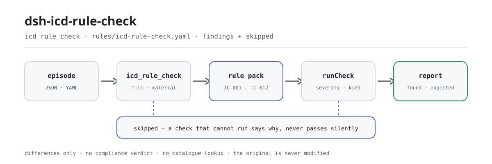

<div align="center">

<picture>
  <source media="(prefers-color-scheme: dark)" srcset="docs/assets/dsh-icd-rule-check-flow-dark.svg">
  
</picture>

# dsh-icd-rule-check

**逐份核对 ICD-10 诊断编码与 ICD-9-CM-3 手术操作编码的形态、重复、剑号/星号配对与字段完整性——输出「哪一行、哪一栏、差什么」的清单。**

面向病案编码员与质控科的 DeepSeek Harness 检查插件：规则包逐条引用公开条款原文，只列材料与条款之间的字面差异，不判合规、不认定责任、不查编码目录、不改原件。

[安装](#三步上手) · [配置](#配置) · [FAQ](#faq) · [简体中文](README.md) · [English](README.en.md) · [Español](README.es.md) · [Português](README.pt.md) · [हिन्दी](README.hi.md)

[](LICENSE)
[](#兼容性)
[](https://www.npmjs.com/package/dsh-icd-rule-check)
[](https://github.com/PerryLink/dsh-icd-rule-check/actions/workflows/ci.yml)
[](#兼容性)

[](https://github.com/PerryLink/dsh-icd-rule-check/stargazers)
[](https://www.npmjs.com/package/dsh-icd-rule-check)
[](https://dshfind.com/plugins/PerryLink/dsh-icd-rule-check?ref=badge)
[](https://securityscorecards.dev/viewer/?uri=github.com/PerryLink/dsh-icd-rule-check)
[](https://dsh.market/)
[](https://gitee.com/perrylink/dsh-icd-rule-check)

```sh
dsh plugin --profile <name> add dsh-icd-rule-check
```

</div>

<sub>社区插件，与 DeepSeek 官方无关。唯一仓库：<https://github.com/PerryLink/dsh-icd-rule-check>（Gitee 为镜像）。</sub>

## 它是什么

`dsh-icd-rule-check` 读取一份住院病案首页的编码记录——主要诊断、其他诊断、主要手术操作、其他手术操作以及入院病情代码——核对这份记录自身的结构与相互引用关系：诊断编码是否符合 ICD-10 形式、手术操作编码是否符合 ICD-9-CM-3 形式（形式核对前先剥离 † / * 标记）、同一编码是否被重复列出、星号编码在本份记录中是否与对应的剑号编码成对、是否填写了主要诊断、各条检查所需的栏目是否齐备。你交出原始材料（JSON 或 YAML；Excel 可先转成 JSON/YAML，对话里也能代转），它返回一份「哪一行、哪一栏、差什么」的差异清单。它不判合规、不认定责任、不替代审核人、不查编码目录，也绝不修改原件。

## 三步上手

1. **安装**：

   ```sh
   dsh plugin --profile <name> add dsh-icd-rule-check
   ```

   也可以在 WorkBuddy / 扣子搜「医疗文书质控包」（总包，本检查是其中一项；上架以商城为准）。

2. **最小配置**（默认即可用）：

   ```yaml
   - insert:
       - id: dsh-icd-rule-check
         name: dsh-icd-rule-check
   ```

   全部可调项都在 `src/config.ts` 的 Schemastery schema 里，默认值开箱即用；逐条阈值在 `rules/` 下的规则包里。

3. **验证已生效**：

   ```sh
   dsh --profile <name> --dump-config | grep 'dsh-icd-rule-check'
   ```

   先用 `pnpm run build` 生成 `lib/`，再用自带样例跑一次（约 1 分钟）：

   ```sh
   node samples/quickstart/run.mjs --check
   ```

   样例输入在 `samples/quickstart/input/`，期望输出在 `samples/quickstart/expected/result.json`，运行截图见 `docs/assets/quickstart.png`。

**卸载**：`dsh plugin --profile <name> remove dsh-icd-rule-check`（或从 profile patch 删掉该行）。

## 核心能力

本插件注册 `icd_rule_check` 工具：读入一份编码记录（诊断、手术操作与入院病情），套用带版本的规则包，返回一份结构化报告。

- **规则包即数据** —— 检查规则全部在 `rules/icd-rule-check.yaml` 里，换规则不动代码；规则包在加载期校验，而非被信任。
- **严重级跟着依据走** —— 依据为原则性条款（`derived-from-principle`）的规则封顶 `warn`；依据为本机构配置（`institutional-configuration`）的阈值封顶 `info`；绝不会把原则或本地配置标成 `error`（有测试断言）。
- **空清单不等于没问题** —— 每一项无法执行的检查都会在 `skipped` 里自报原因；`pairs`、`correspondence` 未配置的规则自报 `skipped`，而不是静默通过。
- **不裁决** —— 报告只列差异，永不判定合规、责任或对错；措辞守卫强制报告始终携带免责声明。
- **引文必须逐字** —— 每条规则带文件名、文号、按原文自身编号体系的条款号、逐字摘录与来源链接；加载器拒绝不足八个字符的摘录，且依据仅为一般原则或本机构配置的检查绝不被标为 `error`。
- **不查码** —— 它只核对编码的形式与记录内部关系，不核对某个编码是否存在于你的目录：那需要一张取得授权、且版本与编码员所用版本一致的编码表，版本不一致只会产出信誓旦旦的错误结论。

```text
住院病案首页编码记录（JSON · YAML）──icd_rule_check──▶ 规则包 IC-001…IC-012 ──▶ 报告（findings + skipped）
        ▲                                                                          │
        └──────────────────────────── 原件永不修改 ────────────────────────────────┘
```

### 规则一览

| 规则 | 核对内容 | 严重级 | 依据类型 |
|---|---|---|---|
| `IC-001` | 诊断编码符合 ICD-10 形式（先剥离 † / * 标记） | error | 直接条款 |
| `IC-002` | 诊断列表不重复列出同一编码 | warn | 原则性条款 |
| `IC-003` | 星号编码与对应的剑号编码在同一份记录中成对 | error | 直接条款 |
| `IC-004` | 诊断编码仍使用星号（*）形式（开关，默认关闭） | info | 本机构配置 |
| `IC-005` | 主要手术操作与主要诊断分组对应（对照表，默认关闭） | warn | 直接条款 |
| `IC-006` | 入院病情为「无」的诊断不作为主要诊断 | warn | 原则性条款 |
| `IC-007` | 手术操作编码符合 ICD-9-CM-3 形式 | error | 直接条款 |
| `IC-008` | 主诉与诊断名称有可识别的字面呼应 | info | 原则性条款 |
| `IC-009` | 填写了主要诊断 | error | 直接条款 |
| `IC-010` | 诊断同时填写规范的诊断名称（开关，默认关闭） | info | 本机构配置 |
| `IC-011` | 主要诊断为 T80-T88 系列并发症时有其他诊断说明 | error | 直接条款 |
| `IC-012` | 第十八章症状体征在有明确诊断时不作为主要诊断 | warn | 原则性条款 |

### 示例

以下为插件真实入口；安装后调用一次即可。

**详细输出** — 工具 `icd_rule_check`，输入：

```json
{"principalDiagnosis":{"code":"急性心肌梗死","name":"急性心肌梗死"},"otherDiagnoses":[{"code":"I10","name":"高血压"}],"principalProcedure":{"code":"36.0600","name":"冠状动脉支架植入术"}}
```

输出：

```json
{
  "id": "dsh-icd-rule-check.IC-001.5a91e9d3",
  "ruleId": "IC-001",
  "severity": "error",
  "locator": {
    "column": "主要诊断",
    "cell": "急性心肌梗死"
  },
  "found": "诊断编码「急性心肌梗死」不符合 ICD-10 形式",
  "expected": "疾病诊断编码应当统一使用 ICD-10，形式为 ^[A-Z][0-9]{2}(\\.[0-9A-Z]{1,4})?$"
}
```

*Observed from `dsh-icd-rule-check/tests/fixtures/IC-001/IC-001-unsafe.json`*

### 它回答什么问题

| 你会问 | 它怎么答 |
|---|---|
| 导出的诊断编码写的是 `A18.1†`，剑号会不会让形式核对报错？ | 不会。`IC-001` 在做形式核对前先剥离星剑号标记（† / *），标记本身不会产生差异。它只核对编码的形式：形式合规但在你所用目录中并不存在的编码仍然通过，因为核对这一点需要与编码员版本一致的授权目录。 |
| 主要诊断这一栏是空的，会报出什么？ | `IC-009` 会报出这份记录没有主要诊断，并提示补填。它的限度是：只核对这一栏是否填写，不判断被选作主要诊断的那一条是否正确——那是编码员的判断，本条不代为作出。 |
| 诊断列表里有一个星号编码，但没有与之对应的剑号编码。 | `IC-003` 会在对照表为该星号编码指定的剑号编码未出现在同一份记录中时报出它。这是本规则库中机械化程度最高的判定，且需要你自己在 `pairs` 里填对照表；`pairs` 留空时本条报告「无法执行」，而不是静默通过。它的限度就在配对本身：中文病案界「星号不能作主要诊断」的转述，本规则库不采用。 |
| 同一个诊断编码被列了两次。 | `IC-002` 会报出重复出现的编码，按「同一诊断被列两次」处理。本条封顶 `warn`：未找到明文规定不得重复，其依据是原则性条款，因此只把该行提示出来供复核，不作阻断。 |
| 主要诊断是 T82 系列并发症，诊断列表里没有其他诊断。 | `IC-011` 会报出该行。主要诊断落在 T80-T88 系列时，它只核对诊断列表中是否存在除主要诊断以外的其他诊断：条文要求「另编码」对该并发症进行说明，但未规定应另编哪一条，本条不代为决定，那属于编码员与所用目录的判断。 |
| `IC-005` 在我们的导出上从来不报任何东西，是不是说明主要手术与主要诊断相符？ | 不是。`IC-005` 出厂时 `correspondence` 对照表为空，它会在 `skipped` 里说明未配置对照表；那里的空结果不等于通过。按本机构的诊断→手术分组把 `correspondence` 填上（`procedures` 为空列表表示该组不应有主要手术），本条才开始比对。 |

## 配置

全部可调参数都在 `src/config.ts` 的 Schemastery schema 中，只改 `cordis.yml` 即可生效，无需改代码；逐条阈值在 `rules/` 下的规则库文件里。全部配置键即下表 5 个；规则级参数见表后。

| 键 | 类型 | 默认值 | 说明 |
|---|---|---|---|
| `rulesFile` | string | `rules/icd-rule-check.yaml` | 规则库文件路径，相对插件包根目录；替换该文件即可切换规则集版本 |
| `disabledRules` | string[] | `[]` | 要停用的规则 id 列表；每条都会出现在 `skipped` 中 |
| `onlyRules` | string[] | `[]` | 只执行这些规则 id；留空表示执行全部规则 |
| `skipNotes` | string | `""` | 附加到每条 `skipped` 说明后的备注，例如标注本机构实施细则 |
| `timeoutMs` | number | `120000` | 工具协作式超时预算（毫秒） |

值得知道的规则级参数：

- `IC-003` `pairs` —— 你的剑号↔星号对照表，形如 `[{ dagger, asterisk }]`。留空表示本条无法执行，并会自报 `skipped`。
- `IC-005` `correspondence` —— 你的诊断→手术分组，形如 `[{ diagnosis: [I21], procedures: [36.06, 36.07] }]`。`procedures` 为空列表表示该组不应有主要手术。
- `IC-004` `flagAsteriskUse` 与 `IC-010` `requireNames` —— 默认关闭，按你的目录与填报规则再打开。
- `IC-006` `flagCode` —— 表示「无入院病情」的代码，默认 `4`。

## FAQ

<details>
<summary>我的材料会被改动或上传吗？</summary>

不会。工具只读取你交出的 JSON/YAML 材料文本，**绝不修改原件**；插件是纯 ESM、无原生代码、**不联网、不调用模型**（见「兼容性」），材料不离开你的机器。工具入口为 `file`（绝对路径）或 `material`（内联文本），二选一。

</details>

<details>
<summary>`pairs` 或 `correspondence` 没配时会静默通过吗？</summary>

不会。`IC-003` 的 `pairs` 与 `IC-005` 的 `correspondence` 出厂均为空，未配置的规则会把自己报进 `skipped` 并写明原因——空的差异清单不会被读成「没有问题」。按本机构目录填好对照表之后，这两条才开始比对。

</details>

<details>
<summary>一个我确定有效的编码被报成形式不符，怎么办？</summary>

`IC-001` 只核对形式。若你的目录使用 `^[A-Z][0-9]{2}(\.[0-9A-Z]{1,4})?$` 之外的写法，请在规则包里改这条模式；它不查编码是否存在于目录，所以形式合规的编码一定通过。

</details>

<details>
<summary>插件装上了但工具不出现，怎么办？</summary>

确认 `main` 指向 `lib/index.mjs` 且 `pnpm run build` 已生成该文件；`main` 写错会让加载器静默跳过该条目。

</details>

<details>
<summary>安装时被判版本不兼容，怎么办？</summary>

peer 范围覆盖 `0.1.x` 与 `0.2.x`；若你的运行时在其之外，可显式豁免：`dsh plugin --profile <name> allow-version dsh-icd-rule-check@0.1.0 --dsh-version <runtime> --accept-risk`。安装期的 peer 校验以运行时为准。

</details>

## 依据的标准

| 文件 | 文号 | 引用它的规则 |
|---|---|---|
| 《住院病案首页数据填写质量规范（暂行）》 | 国卫办医发〔2016〕24号 | IC-001, IC-002, IC-004, IC-005, IC-007, IC-008, IC-009, IC-010, IC-012 |
| 《疾病和有关健康问题的国际统计分类》第十次修订本 第二卷 指导手册 | WHO ICD-10 Volume 2（第二版，2004，ISBN 92 4 154653 0） | IC-003 |
| 《疾病分类与代码》 | GB/T 14396-2016 | IC-003 |
| 《疾病分类与代码国家临床版 2.0》 | 国卫办医函〔2019〕371号 附件1 | IC-003 |
| 《医疗保障基金结算清单填写规范（试行）》 | 医保办发〔2020〕20号 | IC-005, IC-011, IC-006, IC-010, IC-012 |
| 《住院病案首页数据质量管理与控制指标（2016版）》 | 国卫办医发〔2016〕24号 | IC-009 |

**边界：** 本插件对一次住院的编码做**结构性**核对——编码形态、重复、剑号/星号配对、字段完整性——并报出与所引条款之间的字面差异。它不是 `dsh-medrec-qc`（后者整体核对病案首页，包括其中的逻辑矛盾），不是编码目录，也不是编码器。它从不查码：查码需要一张取得授权、且版本与编码员所用版本一致的编码表，而版本不一致只会产出信誓旦旦的错误结论。

> ### ⚠️ 本插件刻意**不**做的两件事，以及为什么
>
> **它不实现合并编码规则，也不替编码员判定主要手术操作与主要诊断是否相匹配。** 构建本插件时所依据的任务把合并编码列为关键路径风险：相关规则散见于 ICD 用户指南、临床版手册和编码员培训材料，而且**找不到可公开逐字引用的国家条款**。本规则库遵循「依据无法引用的条目不得收录」，因此没有编造条款编号，只把主要手术与主要诊断的一致性做成 `IC-005` 的参数化对照——它的依据已升级为 `direct`（24 号文第十一条（二）、第二十二条，与医保办发〔2020〕20 号说明一第 4 条），但**诊断→手术对照关系不内置**：`correspondence` 出厂为空，按本机构目录填好后才开始比对，未填时自报 `skipped`。
>
> **它不内置剑号/星号对照表。** †/* 体系来自 ICD-10 第 2 卷使用指导手册（† 表示在此分类的疾病，* 表示在他处分类的表现），成对使用的要求是该体系的结构性后果。`IC-003` 引用的是该手册 3.1.3 的英文原文（“For coding, the asterisk code must never be used alone.”）与 GB/T 14396-2016 第 4 章的符号定义，因此依据类型为 `direct`、严重级为 `error`；它不内置的是**配对数据**——`pairs` 对照表（剑号↔星号）出厂为空，因为表的版本必须与编码员使用的目录相匹配，未填写时本条自报 `skipped`。

## 材料格式

工具接受 JSON 或 YAML。字段在读取层可选，由检查引擎校验，因此部分导出的材料会产生「缺项」类差异，而不是让程序崩溃。

```yaml
principalDiagnosis: { code: "I21.900", name: 急性心肌梗死 }
otherDiagnoses:
  - { code: "I10", name: 高血压 }
principalProcedure: { code: "36.0600", name: 冠状动脉支架植入术 }
otherProcedures: []
chiefComplaint: 突发心肌梗死样胸痛 3 小时
admissionCondition:
  "I21.900": "1"     # 驱动 IC-006
```

条目也可以只写编码字符串（`principalDiagnosis: I21.900`）；诊断或手术操作可以带 ICD-10 星剑号标记（`A18.1†`、`N51.0*`）——形式核对前会先剥离标记，因此标记本身不会触发 `IC-001`。

## 规则来源

规则数据在 `rules/icd-rule-check.yaml`，与代码分离。每条规则携带文件名、文号、按原文自身编号体系的条款号、逐字摘录与来源链接。加载器强制：摘录必须是真实引文且不少于八个字符；依据仅为一般原则或本机构配置的检查**永远不能**标为 `error`。

所引条款来自《住院病案首页数据填写质量规范（暂行）》与《住院病案首页数据质量管理与控制指标（2016版）》（国卫办医发〔2016〕24号），以及《医疗保障基金结算清单填写规范（试行）》（医保办发〔2020〕20号）。两次研究结论塑造了本规则包，并记录在其头部：

1. **找不到可引用的合并编码条款**，因此这里没有合并编码规则。那次调查诚实的产出是一个默认留空的参数化挂钩，而不是一条带编造条款号的规则。
2. **星号形式的地位取决于目录版本。** 国家临床版与医保版对它的处理不同，因此 `IC-004` 是开关而不是规则。

完整的条款核验记录（含经核查后被弃用的来源）见 `rules/evidence/`。

## 兼容性

| 项目 | 状态 |
|---|---|
| Harness | 对等版本范围 `>=0.1.2-rc.1 <0.2.0 \|\| >=0.2.0-0 <0.3.0` —— 已实测同时接受 `0.2.0-rc.2` 与 `0.2.1-rc.2`。已声明 `engines.dsh`：`>=0.2.1-0 <0.3.0`，0.2.1 起由宿主单独裁决 |
| Node | `^22.19.0 \|\| >=24.0.0` |
| 平台 | 全平台（纯 ESM；无原生代码、无联网、不调用模型） |
| 工具模式 | `native` / `ptc` 均可；批量校验整个目录时建议 `ptc`，schema 成本只付一次 |

## 故障排查

- **`IC-003` 或 `IC-005` 自报 skipped。** 它们需要的对照表为空。用编码员所用版本把 `pairs` 或 `correspondence` 填上。
- **一个已知有效的编码被报形式不符。** `IC-001` 只核对形式；若目录使用 `^[A-Z][0-9]{2}(\.[0-9A-Z]{1,4})?$` 之外的拼写，请在规则包里改这条模式。
- **`IC-008` 在临床上合理的记录上触发。** 它按字面片段比较主诉与诊断**名称**，这是字符串操作，不是编码判断。补上你实际使用的名称，或停用该规则。
- **插件装上了但工具不出现。** 确认 `main` 指向 `lib/index.mjs` 且 `pnpm run build` 已生成该文件；`main` 写错会让加载器静默跳过该条目。
- **`dsh plugin add` 以不兼容为由拒绝。** peer 范围覆盖 `0.1.x` 与 `0.2.x`；若运行时在其之外，可显式豁免：`dsh plugin --profile <name> allow-version dsh-icd-rule-check@0.1.0 --dsh-version <runtime> --accept-risk`
- **`check` 报 `manifest-peers` 失败。** 静态检查器比对的是一份早于 0.2 世代的硬编码 peer 范围；安装期的 peer 校验以运行时为准，声明的范围才是正确的。这是 `dsh-plugin-dev` 的已知上游问题。

## 生态与质量

- [Gitee 镜像](https://gitee.com/perrylink/dsh-icd-rule-check)（同步镜像，以 GitHub 为准）
- [dshfind 插件页](https://dshfind.com/plugins/PerryLink/dsh-icd-rule-check)（安装量与排名）
- [OpenSSF Scorecard 报告](https://securityscorecards.dev/viewer/?uri=github.com/PerryLink/dsh-icd-rule-check)（由 [.github/workflows/scorecard.yml](.github/workflows/scorecard.yml) 驱动）
- [DSH Market](https://dsh.market/)（已上架）
- [生态实测知识库 · 按材料选核查器](https://perrylink.github.io/zh/checkers/choose/)（完整家族清单：62 个核查器 + 通用插件）

## 开发

```sh
pnpm install
pnpm run typecheck   # tsc --noEmit
pnpm test            # vitest，每条规则配对正/反夹具（tests/fixtures/<RULE>/）
pnpm run build       # tsdown -> lib/index.mjs + lib/index.d.mts
pnpm run verify:self-contained
pnpm run check:lockfile
pnpm run check:readmes   # 五语 README 一致性
pnpm run check:citations # 规则引文核验
node ../scripts/sync-shared.mjs dsh-icd-rule-check   # 从 ../_shared 刷新 src/shared
```

规则包是数据不是代码：改 `rules/*.yaml` 即切换规则集，无需动 TypeScript；规则包在加载期校验，而非被信任。官方发布门禁依次跑 typecheck、test、build、自包含校验、lockfile、五语 README 与引文核验，`prepublishOnly` 会重跑一遍。

| 路径 | 作用 |
|---|---|
| `src/index.ts` | function-plugin 契约（`name`/`inject`/`Config`/`apply`），注册 `icd_rule_check` 并解析随包规则库 |
| `src/config.ts` | Schemastery schema；全部可调项在此，代码里不硬编码 |
| `src/check.ts` | 纯检查核心 `(input, ruleset, options) => Report`：无插件上下文、无 I/O、无时钟、不调用模型 |
| `src/parse.ts` | 规范材料的 JSON/YAML 读取器 |
| `src/view.ts` | 报告面向模型的投影；`src/index.ts` 的 `output.schema` 与它对应 |
| `src/shared/` | 共享件（规则库加载、报告形状、YAML 子集、措辞守卫、表格助手），复制进来以保证包自包含 |
| `rules/icd-rule-check.yaml` | 规则包，12 条规则 |
| `rules/evidence/` | 每条引文的条款核验记录 |
| `tests/fixtures/<RULE>/` | 每条规则配对的合规/违规夹具 |

README 配图由 [`scripts/gen-readme-assets.py`](scripts/gen-readme-assets.py) 程序化生成（Python + Pillow），可重复执行；本插件无 UI，hero 为手绘 SVG 流程图（深浅双版，图内仅命令面 token）。

Topics：`dsh`, `dsh-plugin`, `deepseek-harness`, `deepseek`, `cordis`, `icd`, `rule`

## 家族与致谢

本项目是 [PerryLink](https://github.com/PerryLink) 维护的 DeepSeek Harness 插件家族成员（全部 Apache-2.0）。如果这个插件帮到了你，**给个 star**——它不解锁任何功能，但会让下一个人更容易找到它。

- [@PerryLink](https://github.com/PerryLink) —— 创建者与维护者：`icd_rule_check` 工具、逐字引文的规则包、条款核验记录与五语文档。

<details>
<summary>展开全部插件</summary>

| 插件 | 状态 |
|---|---|
| **[dsh-aqua-input-check](https://github.com/PerryLink/dsh-aqua-input-check)** |  |
| **[dsh-archive-check](https://github.com/PerryLink/dsh-archive-check)** |  |
| **[dsh-auto-review](https://github.com/PerryLink/dsh-auto-review)** |  |
| **[dsh-autotier](https://github.com/PerryLink/dsh-autotier)** | 🧊 已冻结 — 见仓库 README |
| **[dsh-bid-ca-precheck](https://github.com/PerryLink/dsh-bid-ca-precheck)** |  |
| **[dsh-bid-qual-check](https://github.com/PerryLink/dsh-bid-qual-check)** |  |
| **[dsh-cert-mcp](https://github.com/PerryLink/dsh-cert-mcp)** | 🧊 已冻结 — 见仓库 README |
| **[dsh-checkpoint-rewind](https://github.com/PerryLink/dsh-checkpoint-rewind)** |  |
| **[dsh-click](https://github.com/PerryLink/dsh-click)** |  |
| **[dsh-composer-history](https://github.com/PerryLink/dsh-composer-history)** |  |
| **[dsh-contract-stance](https://github.com/PerryLink/dsh-contract-stance)** |  |
| **[dsh-customs-doc-check](https://github.com/PerryLink/dsh-customs-doc-check)** |  |
| **[dsh-data-quality](https://github.com/PerryLink/dsh-data-quality)** |  |
| **[dsh-demurrage-ledger](https://github.com/PerryLink/dsh-demurrage-ledger)** |  |
| **[dsh-doublecheck](https://github.com/PerryLink/dsh-doublecheck)** |  |
| **[dsh-drill-script-check](https://github.com/PerryLink/dsh-drill-script-check)** |  |
| **[dsh-eia-guide-check](https://github.com/PerryLink/dsh-eia-guide-check)** |  |
| **[dsh-emergency-plan](https://github.com/PerryLink/dsh-emergency-plan)** |  |
| **[dsh-essay-rubric-check](https://github.com/PerryLink/dsh-essay-rubric-check)** |  |
| **[dsh-evidence-check](https://github.com/PerryLink/dsh-evidence-check)** |  |
| **[dsh-export-ctl-check](https://github.com/PerryLink/dsh-export-ctl-check)** |  |
| **[dsh-fast](https://github.com/PerryLink/dsh-fast)** |  |
| **[dsh-fmea-table-check](https://github.com/PerryLink/dsh-fmea-table-check)** |  |
| **[dsh-forecast-penalty](https://github.com/PerryLink/dsh-forecast-penalty)** |  |
| **[dsh-fund-research](https://github.com/PerryLink/dsh-fund-research)** |  |
| **[dsh-github](https://github.com/PerryLink/dsh-github)** |  |
| **[dsh-gongwen-flow-check](https://github.com/PerryLink/dsh-gongwen-flow-check)** |  |
| **[dsh-gongwen-word-check](https://github.com/PerryLink/dsh-gongwen-word-check)** |  |
| **[dsh-guard-plan-qc](https://github.com/PerryLink/dsh-guard-plan-qc)** |  |
| **[dsh-hazchem-check](https://github.com/PerryLink/dsh-hazchem-check)** |  |
| **[dsh-hazplan-check](https://github.com/PerryLink/dsh-hazplan-check)** |  |
| **[dsh-hidden-risk-map](https://github.com/PerryLink/dsh-hidden-risk-map)** |  |
| **[dsh-hs-classify](https://github.com/PerryLink/dsh-hs-classify)** |  |
| **[dsh-icd-rule-check](https://github.com/PerryLink/dsh-icd-rule-check)** |  |
| **[dsh-industry-research](https://github.com/PerryLink/dsh-industry-research)** |  |
| **[dsh-lawcite-adapter](https://github.com/PerryLink/dsh-lawcite-adapter)** |  |
| **[dsh-laya](https://github.com/PerryLink/dsh-laya)** |  |
| **[dsh-lc-doc-check](https://github.com/PerryLink/dsh-lc-doc-check)** |  |
| **[dsh-learning-gap-check](https://github.com/PerryLink/dsh-learning-gap-check)** |  |
| **[dsh-library](https://github.com/PerryLink/dsh-library)** |  |
| **[dsh-local-ai](https://github.com/PerryLink/dsh-local-ai)** |  |
| **[dsh-lsp-actions](https://github.com/PerryLink/dsh-lsp-actions)** |  |
| **[dsh-mask](https://github.com/PerryLink/dsh-mask)** |  |
| **[dsh-mcp-panel](https://github.com/PerryLink/dsh-mcp-panel)** |  |
| **[dsh-medrec-qc](https://github.com/PerryLink/dsh-medrec-qc)** |  |
| **[dsh-memento](https://github.com/PerryLink/dsh-memento)** |  |
| **[dsh-nsfc-form-check](https://github.com/PerryLink/dsh-nsfc-form-check)** |  |
| **[dsh-nurse-record-check](https://github.com/PerryLink/dsh-nurse-record-check)** |  |
| **[dsh-observe](https://github.com/PerryLink/dsh-observe)** |  |
| **[dsh-origin-rvc-check](https://github.com/PerryLink/dsh-origin-rvc-check)** |  |
| **[dsh-ota-review-check](https://github.com/PerryLink/dsh-ota-review-check)** |  |
| **[dsh-output-styles](https://github.com/PerryLink/dsh-output-styles)** |  |
| **[dsh-paper-doc-adapter](https://github.com/PerryLink/dsh-paper-doc-adapter)** |  |
| **[dsh-permission-rules](https://github.com/PerryLink/dsh-permission-rules)** |  |
| **[dsh-permit-report-check](https://github.com/PerryLink/dsh-permit-report-check)** |  |
| **[dsh-pipeline-check](https://github.com/PerryLink/dsh-pipeline-check)** |  |
| **[dsh-pleading-draft](https://github.com/PerryLink/dsh-pleading-draft)** |  |
| **[dsh-plugin-doctor](https://github.com/PerryLink/dsh-plugin-doctor)** | 🚫 已退役（仓库已归档） |
| **[dsh-plugin-guide](https://github.com/PerryLink/dsh-plugin-guide)** |  |
| **[dsh-plugin-kit](https://github.com/PerryLink/dsh-plugin-kit)** | 🚫 已退役（仓库已归档） |
| **[dsh-plugin-upgrade](https://github.com/PerryLink/dsh-plugin-upgrade)** | 🚫 已退役（仓库已归档） |
| **[dsh-policy-brief-draft](https://github.com/PerryLink/dsh-policy-brief-draft)** |  |
| **[dsh-power-loss-split](https://github.com/PerryLink/dsh-power-loss-split)** |  |
| **[dsh-power-ticket-check](https://github.com/PerryLink/dsh-power-ticket-check)** |  |
| **[dsh-ppap-check](https://github.com/PerryLink/dsh-ppap-check)** |  |
| **[dsh-protest-deadline](https://github.com/PerryLink/dsh-protest-deadline)** |  |
| **[dsh-railway-window](https://github.com/PerryLink/dsh-railway-window)** |  |
| **[dsh-repair-order-qc](https://github.com/PerryLink/dsh-repair-order-qc)** |  |
| **[dsh-research-report](https://github.com/PerryLink/dsh-research-report)** |  |
| **[dsh-review-reply-check](https://github.com/PerryLink/dsh-review-reply-check)** |  |
| **[dsh-rulefile-check](https://github.com/PerryLink/dsh-rulefile-check)** |  |
| **[dsh-safety-brief-check](https://github.com/PerryLink/dsh-safety-brief-check)** |  |
| **[dsh-score](https://github.com/PerryLink/dsh-score)** |  |
| **[dsh-session-sync](https://github.com/PerryLink/dsh-session-sync)** |  |
| **[dsh-site-log-check](https://github.com/PerryLink/dsh-site-log-check)** |  |
| **[dsh-skill-pack-security](https://github.com/PerryLink/dsh-skill-pack-security)** |  |
| **[dsh-soe-decision-check](https://github.com/PerryLink/dsh-soe-decision-check)** |  |
| **[dsh-soilwater-check](https://github.com/PerryLink/dsh-soilwater-check)** |  |
| **[dsh-sop-sync-check](https://github.com/PerryLink/dsh-sop-sync-check)** |  |
| **[dsh-spc-gbt-adapter](https://github.com/PerryLink/dsh-spc-gbt-adapter)** |  |
| **[dsh-talk](https://github.com/PerryLink/dsh-talk)** |  |
| **[dsh-tender-extract](https://github.com/PerryLink/dsh-tender-extract)** |  |
| **[dsh-tender-matrix](https://github.com/PerryLink/dsh-tender-matrix)** |  |
| **[dsh-test-drive](https://github.com/PerryLink/dsh-test-drive)** |  |
| **[dsh-ticktick](https://github.com/PerryLink/dsh-ticktick)** | 🚫 已退役（仓库已归档） |
| **[dsh-translate](https://github.com/PerryLink/dsh-translate)** |  |
| **[dsh-warranty-calc](https://github.com/PerryLink/dsh-warranty-calc)** |  |
| **[dsh-budget](https://github.com/PerryLink/dsh-budget)** | 🧊 已冻结 — 见仓库 README |
| **[dsh-claude-move](https://github.com/PerryLink/dsh-claude-move)** | 🧊 已冻结 — 见仓库 README |
| **[dsh-defend](https://github.com/PerryLink/dsh-defend)** | 🧊 已冻结 — 见仓库 README |
| **[dsh-draw](https://github.com/PerryLink/dsh-draw)** | 🧊 已冻结 — 见仓库 README |
| **[dsh-reach](https://github.com/PerryLink/dsh-reach)** | 🧊 已冻结 — 见仓库 README |
| **[dsh-background-agents](https://github.com/PerryLink/dsh-background-agents)** | 🚫 已退役（仓库已归档） |
| **[dsh-session-pin](https://github.com/PerryLink/dsh-session-pin)** | 🚫 已退役（仓库已归档） |
| **[dsh-team-rooms](https://github.com/PerryLink/dsh-team-rooms)** | 🚫 已退役（仓库已归档） |

</details>

## License

[LICENSE](LICENSE)（Apache License 2.0）© 2026 dsh-icd-rule-check contributors

<p align="center"><sub>Apache-2.0 · 社区插件，与 DeepSeek 无关。</sub></p>
