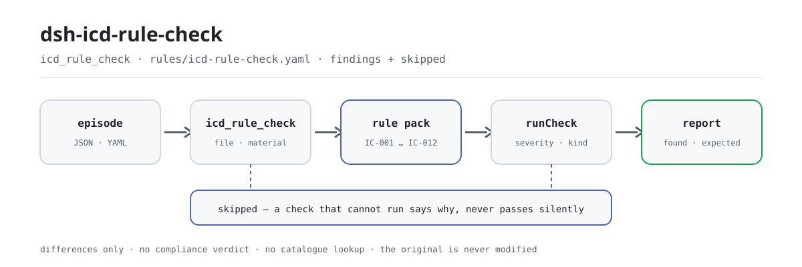

<div align="center">

<picture>
  <source media="(prefers-color-scheme: dark)" srcset="docs/assets/dsh-icd-rule-check-flow-dark.svg">
  
</picture>

# dsh-icd-rule-check

**Verifique a forma ICD-10 e ICD-9-CM-3, duplicatas, o emparelhamento punhal/asterisco e a completude dos campos de um episódio codificado — e receba uma lista do que está inconsistente, onde e o que corrigir.**

Um verificador do DeepSeek Harness para codificadores médicos e controle de qualidade: o pacote de regras cita textualmente suas cláusulas públicas, relata apenas diferenças literais frente às cláusulas citadas, e nunca decide conformidade, não atribui responsabilidade, não procura códigos num catálogo nem toca no seu original.

[Instalar](#instalação-em-três-passos) · [Configuração](#configuração) · [FAQ](#faq) · [简体中文](README.md) · [English](README.en.md) · [Español](README.es.md) · [Português](README.pt.md) · [हिन्दी](README.hi.md)

[](LICENSE)
[](#compatibilidade)
[](https://www.npmjs.com/package/dsh-icd-rule-check)
[](https://github.com/PerryLink/dsh-icd-rule-check/actions/workflows/ci.yml)
[](#compatibilidade)

[](https://github.com/PerryLink/dsh-icd-rule-check/stargazers)
[](https://www.npmjs.com/package/dsh-icd-rule-check)
[](https://dshfind.com/plugins/PerryLink/dsh-icd-rule-check?ref=badge)
[](https://securityscorecards.dev/viewer/?uri=github.com/PerryLink/dsh-icd-rule-check)
[](https://dsh.market/)
[](https://gitee.com/perrylink/dsh-icd-rule-check)

```sh
dsh plugin --profile <name> add dsh-icd-rule-check
```

</div>

<sub>Plugin da comunidade, sem afiliação com a DeepSeek. Repositório canônico: <https://github.com/PerryLink/dsh-icd-rule-check> (o Gitee é um espelho).</sub>

## O que é

`dsh-icd-rule-check` lê um episódio de internamento codificado —o diagnóstico principal, os outros diagnósticos, o procedimento principal, os outros procedimentos e os códigos de circunstância de admissão— e verifica a estrutura e as referências internas desse mesmo episódio: se cada código de diagnóstico tem forma ICD-10 e cada código de procedimento forma ICD-9-CM-3 (os marcadores † / * são retirados antes da verificação de forma), se o mesmo código de diagnóstico não é listado duas vezes, se um código de asterisco tem o seu código de punhal no mesmo episódio, se existe um diagnóstico principal e se estão preenchidos os campos de que cada verificação precisa. Você entrega o material original (JSON ou YAML; o Excel pode ser convertido antes para JSON/YAML, no chat se a plataforma permitir) e recebe uma lista de diferenças. Não decide conformidade, não atribui responsabilidade, não substitui o revisor, não procura códigos num catálogo e nunca altera o original.

## Instalação em três passos

1. **Instale**:

   ```sh
   dsh plugin --profile <name> add dsh-icd-rule-check
   ```

   Também pode buscar «Medical Record QC Suite» no WorkBuddy / Coze (o conjunto completo; esta verificação é uma parte; disponibilidade conforme o catálogo).

2. **Configuração mínima** (funciona tal como vem):

   ```yaml
   - insert:
       - id: dsh-icd-rule-check
         name: dsh-icd-rule-check
   ```

   Todos os parâmetros ajustáveis ficam no esquema Schemastery de `src/config.ts` e os padrões estão prontos para produção; os limites por regra ficam no pacote de regras sob `rules/`.

3. **Verifique que ele monta**:

   ```sh
   dsh --profile <name> --dump-config | grep 'dsh-icd-rule-check'
   ```

   Execute antes `pnpm run build` para gerar `lib/` e então o exemplo incluído (cerca de um minuto):

   ```sh
   node samples/quickstart/run.mjs --check
   ```

   A entrada do exemplo está em `samples/quickstart/input/`, a saída esperada em `samples/quickstart/expected/result.json` e a captura de execução em `docs/assets/quickstart.png`.

**Desinstalar**: `dsh plugin --profile <name> remove dsh-icd-rule-check` (ou remova a linha do patch de perfil).

## Capacidades principais

O plugin registra a ferramenta `icd_rule_check`: lê um episódio codificado (diagnósticos, procedimentos e circunstância de admissão), aplica um pacote de regras versionado e devolve um relatório estruturado.

- **O pacote de regras é dado, não código** — cada verificação vive em `rules/icd-rule-check.yaml`, então trocar o conjunto de regras não toca no TypeScript; o pacote é validado ao carregar, não é confiado.
- **A gravidade segue a evidência** — uma regra baseada em princípio geral (`derived-from-principle`) fica limitada a `warn`; um limite institucional (`institutional-configuration`) fica limitado a `info`; nenhuma pode ser declarada `error` (há um teste que o afirma).
- **Uma lista vazia nunca significa «não há nada errado»** — toda verificação que não pôde rodar se declara em `skipped` com o motivo; uma regra cuja tabela `pairs` ou `correspondence` não está configurada se declara em `skipped` em vez de passar em silêncio.
- **Sem adjudicação** — o relatório apenas lista diferenças e nunca se pronuncia sobre conformidade, responsabilidade ou correção; um guardião de redação obriga o relatório a levar sempre o aviso de isenção.
- **As citações devem ser literais** — cada regra leva documento, número, cláusula na numeração própria da fonte, trecho literal e URL de origem; o carregador rejeita um trecho com menos de oito caracteres, e uma regra baseada apenas em princípio geral ou configuração local nunca pode ser marcada como `error`.
- **Sem consulta a catálogo** — verifica a forma do código e as relações internas do registro, não se um código existe no seu catálogo: isso exige uma tabela licenciada cuja versão coincida com a do codificador, e uma versão diferente só produz conclusões falsas com segurança.

```text
episódio codificado (JSON · YAML) ──icd_rule_check──▶ pacote IC-001…IC-012 ──▶ relatório (findings + skipped)
        ▲                                                                              │
        └────────────────────────── o original nunca é alterado ───────────────────────┘
```

### As regras num relance

| Regra | Verificação | Gravidade | Tipo de base |
|---|---|---|---|
| `IC-001` | todo código de diagnóstico tem forma ICD-10 († / * retirados antes) | error | direta |
| `IC-002` | o mesmo código de diagnóstico não é listado duas vezes | warn | princípio |
| `IC-003` | um código de asterisco tem o seu código de punhal no mesmo episódio | error | direta |
| `IC-004` | um diagnóstico ainda usa a forma asterisco (*) (interruptor, desligado por padrão) | info | institucional |
| `IC-005` | o procedimento principal agrupa-se com o diagnóstico principal (tabela, desligado por padrão) | warn | direta |
| `IC-006` | um diagnóstico marcado «não presente na admissão» não é o diagnóstico principal | warn | princípio |
| `IC-007` | todo código de procedimento tem forma ICD-9-CM-3 | error | direta |
| `IC-008` | a queixa principal e os nomes de diagnóstico partilham um fragmento literal | info | princípio |
| `IC-009` | existe um diagnóstico principal | error | direta |
| `IC-010` | os diagnósticos levam nome, não apenas código (interruptor, desligado por padrão) | info | institucional |
| `IC-011` | uma complicação T80-T88 como diagnóstico principal leva um diagnóstico adicional | error | direta |
| `IC-012` | um sintoma do capítulo XVIII da CID-10 não é o diagnóstico principal quando existe um diagnóstico definido | warn | princípio |

### Exemplos

Estes são os pontos de entrada reais do plugin; instale uma vez e chame um.

**Saída detalhada** — ferramenta `icd_rule_check`, entrada:

```json
{"principalDiagnosis":{"code":"急性心肌梗死","name":"急性心肌梗死"},"otherDiagnoses":[{"code":"I10","name":"高血压"}],"principalProcedure":{"code":"36.0600","name":"冠状动脉支架植入术"}}
```

Saída:

```json
{
  "id": "dsh-icd-rule-check.IC-001.5a91e9d3",
  "ruleId": "IC-001",
  "severity": "error",
  "locator": {
    "column": "主要诊断",
    "cell": "急性心肌梗死"
  },
  "found": "诊断编码「急性心肌梗死」不符合 ICD-10 形式",
  "expected": "疾病诊断编码应当统一使用 ICD-10，形式为 ^[A-Z][0-9]{2}(\\.[0-9A-Z]{1,4})?$"
}
```

*Observed from `dsh-icd-rule-check/tests/fixtures/IC-001/IC-001-unsafe.json`*

### O que ele responde

| Você pergunta | O que ele responde |
|---|---|
| A exportação guarda o código de diagnóstico como `A18.1†`. O punhal vai fazer disparar a verificação de forma? | Não. `IC-001` retira os marcadores de punhal e asterisco († / *) antes de examinar o código, por isso o marcador sozinho nunca produz uma diferença. Verifica apenas a forma do código: um código bem formado que o seu catálogo não contenha realmente passa à mesma, porque verificar isso exige um catálogo licenciado da mesma versão que o codificador usa. |
| O campo do diagnóstico principal está vazio. O que é reportado? | `IC-009` reporta que o registo não traz diagnóstico principal e indica que é preciso preenchê-lo. O seu limite: verifica apenas que o campo está preenchido, não que o diagnóstico escolhido como principal seja o correto; essa escolha é do codificador e a regra não a faz. |
| Há um código de asterisco na lista e nenhum código de punhal correspondente. | `IC-003` reporta o código de asterisco quando o código de punhal que a tabela de emparelhamento lhe atribui não aparece no mesmo episódio. É a determinação mais mecânica do pacote e precisa da sua própria tabela em `pairs`; com `pairs` vazio a regra reporta que não pôde ser executada em vez de passar em silêncio. O seu limite é o próprio emparelhamento: o pacote não adota a leitura do meio chinês do registo clínico segundo a qual um código de asterisco não pode ser o diagnóstico principal. |
| O mesmo código de diagnóstico aparece listado duas vezes. | `IC-002` reporta o código repetido e trata-o como o mesmo diagnóstico listado duas vezes. Está limitada a `warn`: não foi encontrada nenhuma cláusula que proíba a repetição com essas palavras, por isso a sua base é um princípio e assinala a linha para revisão em vez de bloquear. |
| O diagnóstico principal é uma complicação da série T82 e não há mais nenhum diagnóstico. | `IC-011` reporta essa linha. Com um diagnóstico principal na série T80-T88 pergunta apenas se existe algum outro diagnóstico além do principal: a cláusula exige um código adicional que descreva a complicação, mas não diz qual, por isso a regra não o escolhe; isso pertence ao codificador e ao catálogo em uso. |
| O `IC-005` nunca reporta nada na nossa exportação — isso significa que o procedimento principal corresponde ao diagnóstico principal? | Não. O `IC-005` é distribuído com a sua tabela `correspondence` vazia, pelo que se declara em `skipped` com o motivo de a tabela não estar configurada; uma lista de diferenças vazia aí não é uma aprovação. Preencha `correspondence` com os seus próprios agrupamentos diagnóstico→procedimento —uma lista `procedures` vazia significa que esse grupo não deve ter procedimento principal— e a regra começa a comparar. |

## Configuração

Todos os parâmetros ajustáveis ficam no esquema Schemastery de `src/config.ts`, portanto mudam pelo `cordis.yml` sem editar código; os limites por regra ficam no pacote de regras sob `rules/`. Estas cinco chaves são toda a superfície de configuração; os parâmetros por regra vêm a seguir.

| Chave | Tipo | Padrão | Descrição |
|---|---|---|---|
| `rulesFile` | string | `rules/icd-rule-check.yaml` | Caminho do pacote de regras, relativo à raiz do pacote; aponte-o para outro lugar para trocar de versão |
| `disabledRules` | string[] | `[]` | Ids de regras a desativar; cada uma aparece em `skipped` |
| `onlyRules` | string[] | `[]` | Executar apenas estas regras; vazio executa todas |
| `skipNotes` | string | `""` | Nota acrescentada a cada motivo de `skipped`, p. ex. as suas regras institucionais |
| `timeoutMs` | number | `120000` | Orçamento de tempo limite cooperativo da ferramenta (ms) |

Parâmetros por regra que vale conhecer:

- `IC-003` `pairs` — a sua tabela punhal↔asterisco, como `[{ dagger, asterisk }]`. Vazia significa que a verificação não pode rodar e di-lo.
- `IC-005` `correspondence` — os seus agrupamentos diagnóstico→procedimento, como `[{ diagnosis: [I21], procedures: [36.06, 36.07] }]`. Uma lista `procedures` vazia significa «este grupo não deve ter procedimento principal».
- `IC-004` `flagAsteriskUse` e `IC-010` `requireNames` — desligados até os ativar para o seu catálogo e regras de apresentação.
- `IC-006` `flagCode` — o código de circunstância de admissão que significa «não presente na admissão». Por padrão `4`.

## FAQ

<details>
<summary>O meu material é alterado ou enviado para algum sítio?</summary>

Não. A ferramenta apenas lê o material JSON/YAML que você entrega e **nunca altera o original**; o plugin é ESM puro, sem código nativo, **sem pedidos de rede e sem chamadas ao modelo** (ver «Compatibilidade»), portanto o material não sai da sua máquina. A entrada é `file` (um caminho absoluto) ou `material` (texto em linha).

</details>

<details>
<summary>Com <code>pairs</code> ou <code>correspondence</code> por configurar, passa em silêncio?</summary>

Não. O `pairs` de `IC-003` e o `correspondence` de `IC-005` vêm vazios, e uma regra não configurada declara-se em `skipped` com o motivo — uma lista de diferenças vazia nunca é lida como «não há nada errado». Preencha as tabelas com os mapeamentos do seu catálogo e essas verificações começam a comparar.

</details>

<details>
<summary>Um código que sei válido é reportado como mal formado. O que faço?</summary>

`IC-001` verifica apenas a forma. Se o seu catálogo usa uma grafia fora de `^[A-Z][0-9]{2}(\.[0-9A-Z]{1,4})?$`, mude esse padrão no pacote de regras; a regra nunca verifica se um código existe num catálogo, por isso um código bem formado passa sempre.

</details>

<details>
<summary>O plugin instala mas a ferramenta não aparece. O que devo verificar?</summary>

Confirme que `main` resolve para `lib/index.mjs` e que `pnpm run build` o gerou; um `main` errado faz o carregador ignorar a entrada em silêncio.

</details>

<details>
<summary><code>dsh plugin add</code> recusa o pacote como incompatível. Que opções tenho?</summary>

A faixa de peers cobre `0.1.x` e `0.2.x`; se o seu runtime ficar fora dela, conceda uma isenção explícita: `dsh plugin --profile <name> allow-version dsh-icd-rule-check@0.1.0 --dsh-version <runtime> --accept-risk`. Na prática, a compatibilidade de peers é aplicada pelo runtime na instalação.

</details>

## Normas que segue

| Documento | Número | Regras que o citam |
|---|---|---|
| Especificação de qualidade para o preenchimento da folha de ingresso hospitalar (provisória) | Guowei Bianyi Fa [2016] No. 24 | IC-001, IC-002, IC-004, IC-005, IC-007, IC-008, IC-009, IC-010, IC-012 |
| Classificação internacional de doenças e problemas relacionados à saúde, 10.ª revisão, Volume 2 — manual de instruções | WHO ICD-10 Volume 2 (2.ª ed., 2004, ISBN 92 4 154653 0) | IC-003 |
| Classificação e códigos de doenças | GB/T 14396-2016 | IC-003 |
| Versão clínica nacional 2.0 da classificação e códigos de doenças | Guowei Bianyi Han [2019] No. 371, Anexo 1 | IC-003 |
| Especificação para o preenchimento da lista de liquidação do fundo de seguro médico (ensaio) | Yibaoban Fa [2020] No. 20 | IC-005, IC-011, IC-006, IC-010, IC-012 |
| Indicadores de gestão e controle de qualidade dos dados da folha de ingresso hospitalar (edição 2016) | Guowei Bianyi Fa [2016] No. 24 | IC-009 |

Títulos originais dos documentos citados:

```text
《住院病案首页数据填写质量规范（暂行）》 国卫办医发〔2016〕24号
《疾病和有关健康问题的国际统计分类》第十次修订本 第二卷 指导手册 WHO ICD-10 Volume 2
《疾病分类与代码》 GB/T 14396-2016
《疾病分类与代码国家临床版 2.0》 国卫办医函〔2019〕371号 附件1
《医疗保障基金结算清单填写规范（试行）》 医保办发〔2020〕20号
《住院病案首页数据质量管理与控制指标（2016版）》 国卫办医发〔2016〕24号
```

**Limite:** este plugin realiza verificações **estruturais** sobre os códigos de um episódio de internamento —forma do código, duplicatas, emparelhamento punhal/asterisco, completude de campos— e relata diferenças literais frente às cláusulas citadas. Não é o `dsh-medrec-qc` (que verifica a folha de ingresso inteira, incluindo as suas contradições lógicas), não é um catálogo de códigos nem um codificador. Nunca procura um código: uma consulta de catálogo exige uma tabela licenciada cuja versão coincida com a do codificador, e uma versão diferente produz conclusões falsas com segurança.

> ### ⚠️ Duas coisas que este plugin deliberadamente **não** faz, e por quê
>
> **Não implementa uma regra de código combinado nem decide pelo codificador se o procedimento principal corresponde ao diagnóstico principal.** A tarefa a partir da qual este plugin foi construído sinalizou a codificação combinada como risco de caminho crítico: as regras estão dispersas entre guias do usuário da CID, o manual da versão clínica e material de formação de codificadores, e **nenhuma cláusula nacional citável publicamente** foi encontrada. Este pacote de regras baseia-se na regra de que uma entrada cuja base não pode ser citada não entra, por isso não inventa um número de cláusula e converte essa verificação de consistência na comparação parametrizada do `IC-005` — a sua base foi elevada a `direct` (Guowei Bianyi Fa [2016] No. 24, art. 11(2) e art. 22; Yibaoban Fa [2020] No. 20, anexo 1, nota 1, ponto 4), mas a **tabela diagnóstico→procedimento não é incluída**: `correspondence` vem vazia, a comparação começa quando a preencher para o seu catálogo e, até lá, a regra declara-se em `skipped`.
>
> **Não inclui uma tabela de emparelhamento punhal/asterisco.** O sistema †/* vem do manual de instruções do Volume 2 da CID-10 († marca uma condição classificada aqui, * uma manifestação classificada noutro lugar), e o requisito de emparelhamento é uma consequência estrutural desse sistema. `IC-003` cita o original inglês do §3.1.3 («For coding, the asterisk code must never be used alone.») e as definições de símbolos da GB/T 14396-2016, por isso a sua base é `direct` e a gravidade `error`; o que não inclui são os **dados de emparelhamento**: a tabela `pairs` vem vazia porque a versão tem de coincidir com o catálogo do codificador, e a regra declara-se em `skipped` até a preencher.

## Formato do material

A ferramenta aceita JSON ou YAML. Os campos são opcionais na camada de leitura e validados pelo motor, de modo que uma exportação parcial gera achados sobre o que falta em vez de falhar.

```yaml
principalDiagnosis: { code: "I21.900", name: 急性心肌梗死 }
otherDiagnoses:
  - { code: "I10", name: 高血压 }
principalProcedure: { code: "36.0600", name: 冠状动脉支架植入术 }
otherProcedures: []
chiefComplaint: 突发心肌梗死样胸痛 3 小时
admissionCondition:
  "I21.900": "1"     # alimenta o IC-006
```

Uma entrada também pode ser uma cadeia de código só (`principalDiagnosis: I21.900`), e um diagnóstico ou procedimento pode levar os marcadores da CID-10 (`A18.1†`, `N51.0*`): são retirados antes da verificação de forma, por isso um marcador nunca dispara o `IC-001`.

## Fontes das regras

Os dados das regras ficam em `rules/icd-rule-check.yaml`, separados do código. Cada regra traz documento, número, cláusula na numeração própria da fonte, trecho literal e URL de origem. O carregador impõe que o trecho seja citação real de pelo menos oito caracteres e que uma verificação baseada apenas em princípio geral ou em política local nunca seja declarada `error`.

As cláusulas citadas vêm da Especificação de qualidade para o preenchimento da folha de ingresso hospitalar (provisória) e dos indicadores de controle de qualidade de 2016 (Guowei Bianyi Fa [2016] No. 24), e da Especificação para o preenchimento da lista de liquidação do fundo de seguro médico (ensaio) (Yibaoban Fa [2020] No. 20). Dois achados da investigação moldaram o pacote e ficam registados nele:

1. **Nenhuma cláusula citável foi encontrada para a codificação combinada**, por isso aqui não existe uma regra de código combinado. O resultado honesto dessa investigação é um gancho parametrizado vazio por padrão, não uma regra com um número de cláusula inventado.
2. **A posição da forma asterisco depende da versão do catálogo.** A versão clínica nacional e a versão do seguro tratam-na de forma diferente, por isso `IC-004` é um interruptor e não uma regra.

O registo completo de verificação de cláusulas (incluindo fontes verificadas e depois descartadas) está em `rules/evidence/`.

## Compatibilidade

| Superfície | Estado |
|---|---|
| Harness | Faixa de peers `>=0.1.2-rc.1 <0.2.0 \|\| >=0.2.0-0 <0.3.0` — verificada para aceitar tanto `0.2.0-rc.2` quanto `0.2.1-rc.2`. **`engines.dsh` é declarado como `>=0.2.1-0 <0.3.0`** e o host o aplica desde 0.2.1 |
| Node | `^22.19.0 \|\| >=24.0.0` |
| Plataformas | Todas (ESM puro; sem código nativo, sem rede, sem chamada ao modelo) |
| Modo de ferramenta | Funciona em `native` e `ptc`; para um lote de registos use `ptc`, o custo do esquema é pago uma vez |

## Resolução de problemas

- **`IC-003` ou `IC-005` declaram-se em skipped.** A tabela de que precisam está vazia. Preencha `pairs` ou `correspondence` com a versão que os seus codificadores usam.
- **Um código que sabe válido é reportado como mal formado.** `IC-001` verifica apenas a forma; se o seu catálogo usa uma grafia fora de `^[A-Z][0-9]{2}(\.[0-9A-Z]{1,4})?$`, mude o padrão no pacote de regras.
- **`IC-008` dispara num registo clinicamente sensato.** Compara a queixa principal com os **nomes** de diagnóstico por fragmento literal, o que é uma operação de cadeias, não um juízo de codificação. Acrescente o nome que usa ou desative a regra.
- **O plugin instala mas a ferramenta não aparece.** Confirme que `main` resolve para `lib/index.mjs` e que `pnpm run build` o gerou; um `main` errado faz o carregador ignorar a entrada em silêncio.
- **`dsh plugin add` recusa o pacote por incompatibilidade.** A faixa de peers cobre `0.1.x` e `0.2.x`; se o seu runtime ficar fora dela, conceda uma isenção explícita: `dsh plugin --profile <name> allow-version dsh-icd-rule-check@0.1.0 --dsh-version <runtime> --accept-risk`
- **`check` informa `manifest-peers` como falha.** O verificador estático compara com um intervalo de peers codificado anterior à linha 0.2; o runtime aplica a compatibilidade na instalação, por isso o intervalo declarado é o correto. É um problema conhecido do `dsh-plugin-dev`.

## Ecossistema e qualidade

- [Espelho no Gitee](https://gitee.com/perrylink/dsh-icd-rule-check) (espelho sincronizado; o GitHub é o canônico)
- [Página no dshfind](https://dshfind.com/plugins/PerryLink/dsh-icd-rule-check) (instalações e ranking)
- [Relatório OpenSSF Scorecard](https://securityscorecards.dev/viewer/?uri=github.com/PerryLink/dsh-icd-rule-check) (impulsionado por [.github/workflows/scorecard.yml](.github/workflows/scorecard.yml))
- [DSH Market](https://dsh.market/) (listado)
- [Base de conhecimento — escolha um verificador por material](https://perrylink.github.io/zh/checkers/choose/) (a família completa: 62 verificadores + plugins gerais)

## Desenvolvimento

```sh
pnpm install
pnpm run typecheck   # tsc --noEmit
pnpm test            # vitest, fixtures conformes/violadoras emparelhadas por regra (tests/fixtures/<RULE>/)
pnpm run build       # tsdown -> lib/index.mjs + lib/index.d.mts
pnpm run verify:self-contained
pnpm run check:lockfile
pnpm run check:readmes   # consistência dos README em cinco idiomas
pnpm run check:citations # verificação das citações das regras
node ../scripts/sync-shared.mjs dsh-icd-rule-check   # atualiza src/shared a partir de ../_shared
```

O pacote de regras é dado, não código: substituir `rules/*.yaml` troca o conjunto de regras sem tocar no TypeScript, e o pacote é validado ao carregar em vez de ser confiado. O portão de publicação executa typecheck, testes, build, a verificação de autocontenção, lockfile, README em cinco idiomas e verificação de citações; o `prepublishOnly` volta a executá-lo.

| Caminho | Função |
|---|---|
| `src/index.ts` | contrato de plugin de função (`name`/`inject`/`Config`/`apply`); registra `icd_rule_check` e resolve o pacote de regras incluído |
| `src/config.ts` | esquema Schemastery; tudo o que é ajustável vive aqui, nada codificado |
| `src/check.ts` | núcleo puro `(input, ruleset, options) => Report`: sem contexto de plugin, sem E/S, sem relógio, sem modelo |
| `src/parse.ts` | leitor do material canônico JSON/YAML |
| `src/view.ts` | projeção do relatório para o modelo; `output.schema` em `src/index.ts` reflete-a |
| `src/shared/` | kit partilhado (carregamento de regras, forma do relatório, subconjunto YAML, guardião de redação, ajudas de tabela), copiado para o pacote ficar autocontido |
| `rules/icd-rule-check.yaml` | pacote de regras, 12 regras |
| `rules/evidence/` | registo de verificação de cada citação |
| `tests/fixtures/<RULE>/` | fixtures conformes/violadoras emparelhadas por regra |

As imagens do README são geradas programaticamente por [`scripts/gen-readme-assets.py`](scripts/gen-readme-assets.py) (Python + Pillow) e podem ser reexecutadas; este plugin não tem UI, por isso o hero é um diagrama de fluxo SVG desenhado à mão (variantes clara e escura, apenas tokens da superfície de comandos).

Topics: `dsh`, `dsh-plugin`, `deepseek-harness`, `deepseek`, `cordis`, `icd`, `rule`

## Família e agradecimentos

Este projeto faz parte da família de plugins do DeepSeek Harness mantida pela [PerryLink](https://github.com/PerryLink) (todos Apache-2.0). Se lhe for útil, **uma estrela ajuda a próxima pessoa a encontrá-lo** — nada fica bloqueado por isso.

- [@PerryLink](https://github.com/PerryLink) — criador e mantenedor: a ferramenta `icd_rule_check`, o pacote de regras com citações literais, o registo de verificação de cláusulas e a documentação em cinco idiomas.

<details>
<summary>Expandir todos os plugins</summary>

| Plugin | Status |
|---|---|
| **[dsh-aqua-input-check](https://github.com/PerryLink/dsh-aqua-input-check)** |  |
| **[dsh-archive-check](https://github.com/PerryLink/dsh-archive-check)** |  |
| **[dsh-auto-review](https://github.com/PerryLink/dsh-auto-review)** |  |
| **[dsh-autotier](https://github.com/PerryLink/dsh-autotier)** | 🧊 CONGELADO — ver o README do repo |
| **[dsh-bid-ca-precheck](https://github.com/PerryLink/dsh-bid-ca-precheck)** |  |
| **[dsh-bid-qual-check](https://github.com/PerryLink/dsh-bid-qual-check)** |  |
| **[dsh-cert-mcp](https://github.com/PerryLink/dsh-cert-mcp)** | 🧊 CONGELADO — ver o README do repo |
| **[dsh-checkpoint-rewind](https://github.com/PerryLink/dsh-checkpoint-rewind)** |  |
| **[dsh-click](https://github.com/PerryLink/dsh-click)** |  |
| **[dsh-composer-history](https://github.com/PerryLink/dsh-composer-history)** |  |
| **[dsh-contract-stance](https://github.com/PerryLink/dsh-contract-stance)** |  |
| **[dsh-customs-doc-check](https://github.com/PerryLink/dsh-customs-doc-check)** |  |
| **[dsh-data-quality](https://github.com/PerryLink/dsh-data-quality)** |  |
| **[dsh-demurrage-ledger](https://github.com/PerryLink/dsh-demurrage-ledger)** |  |
| **[dsh-doublecheck](https://github.com/PerryLink/dsh-doublecheck)** |  |
| **[dsh-drill-script-check](https://github.com/PerryLink/dsh-drill-script-check)** |  |
| **[dsh-eia-guide-check](https://github.com/PerryLink/dsh-eia-guide-check)** |  |
| **[dsh-emergency-plan](https://github.com/PerryLink/dsh-emergency-plan)** |  |
| **[dsh-essay-rubric-check](https://github.com/PerryLink/dsh-essay-rubric-check)** |  |
| **[dsh-evidence-check](https://github.com/PerryLink/dsh-evidence-check)** |  |
| **[dsh-export-ctl-check](https://github.com/PerryLink/dsh-export-ctl-check)** |  |
| **[dsh-fast](https://github.com/PerryLink/dsh-fast)** |  |
| **[dsh-fmea-table-check](https://github.com/PerryLink/dsh-fmea-table-check)** |  |
| **[dsh-forecast-penalty](https://github.com/PerryLink/dsh-forecast-penalty)** |  |
| **[dsh-fund-research](https://github.com/PerryLink/dsh-fund-research)** |  |
| **[dsh-github](https://github.com/PerryLink/dsh-github)** |  |
| **[dsh-gongwen-flow-check](https://github.com/PerryLink/dsh-gongwen-flow-check)** |  |
| **[dsh-gongwen-word-check](https://github.com/PerryLink/dsh-gongwen-word-check)** |  |
| **[dsh-guard-plan-qc](https://github.com/PerryLink/dsh-guard-plan-qc)** |  |
| **[dsh-hazchem-check](https://github.com/PerryLink/dsh-hazchem-check)** |  |
| **[dsh-hazplan-check](https://github.com/PerryLink/dsh-hazplan-check)** |  |
| **[dsh-hidden-risk-map](https://github.com/PerryLink/dsh-hidden-risk-map)** |  |
| **[dsh-hs-classify](https://github.com/PerryLink/dsh-hs-classify)** |  |
| **[dsh-icd-rule-check](https://github.com/PerryLink/dsh-icd-rule-check)** |  |
| **[dsh-industry-research](https://github.com/PerryLink/dsh-industry-research)** |  |
| **[dsh-lawcite-adapter](https://github.com/PerryLink/dsh-lawcite-adapter)** |  |
| **[dsh-laya](https://github.com/PerryLink/dsh-laya)** |  |
| **[dsh-lc-doc-check](https://github.com/PerryLink/dsh-lc-doc-check)** |  |
| **[dsh-learning-gap-check](https://github.com/PerryLink/dsh-learning-gap-check)** |  |
| **[dsh-library](https://github.com/PerryLink/dsh-library)** |  |
| **[dsh-local-ai](https://github.com/PerryLink/dsh-local-ai)** |  |
| **[dsh-lsp-actions](https://github.com/PerryLink/dsh-lsp-actions)** |  |
| **[dsh-mask](https://github.com/PerryLink/dsh-mask)** |  |
| **[dsh-mcp-panel](https://github.com/PerryLink/dsh-mcp-panel)** |  |
| **[dsh-medrec-qc](https://github.com/PerryLink/dsh-medrec-qc)** |  |
| **[dsh-memento](https://github.com/PerryLink/dsh-memento)** |  |
| **[dsh-nsfc-form-check](https://github.com/PerryLink/dsh-nsfc-form-check)** |  |
| **[dsh-nurse-record-check](https://github.com/PerryLink/dsh-nurse-record-check)** |  |
| **[dsh-observe](https://github.com/PerryLink/dsh-observe)** |  |
| **[dsh-origin-rvc-check](https://github.com/PerryLink/dsh-origin-rvc-check)** |  |
| **[dsh-ota-review-check](https://github.com/PerryLink/dsh-ota-review-check)** |  |
| **[dsh-output-styles](https://github.com/PerryLink/dsh-output-styles)** |  |
| **[dsh-paper-doc-adapter](https://github.com/PerryLink/dsh-paper-doc-adapter)** |  |
| **[dsh-permission-rules](https://github.com/PerryLink/dsh-permission-rules)** |  |
| **[dsh-permit-report-check](https://github.com/PerryLink/dsh-permit-report-check)** |  |
| **[dsh-pipeline-check](https://github.com/PerryLink/dsh-pipeline-check)** |  |
| **[dsh-pleading-draft](https://github.com/PerryLink/dsh-pleading-draft)** |  |
| **[dsh-plugin-doctor](https://github.com/PerryLink/dsh-plugin-doctor)** | 🚫 APOSENTADO (repo arquivado) |
| **[dsh-plugin-guide](https://github.com/PerryLink/dsh-plugin-guide)** |  |
| **[dsh-plugin-kit](https://github.com/PerryLink/dsh-plugin-kit)** | 🚫 APOSENTADO (repo arquivado) |
| **[dsh-plugin-upgrade](https://github.com/PerryLink/dsh-plugin-upgrade)** | 🚫 APOSENTADO (repo arquivado) |
| **[dsh-policy-brief-draft](https://github.com/PerryLink/dsh-policy-brief-draft)** |  |
| **[dsh-power-loss-split](https://github.com/PerryLink/dsh-power-loss-split)** |  |
| **[dsh-power-ticket-check](https://github.com/PerryLink/dsh-power-ticket-check)** |  |
| **[dsh-ppap-check](https://github.com/PerryLink/dsh-ppap-check)** |  |
| **[dsh-protest-deadline](https://github.com/PerryLink/dsh-protest-deadline)** |  |
| **[dsh-railway-window](https://github.com/PerryLink/dsh-railway-window)** |  |
| **[dsh-repair-order-qc](https://github.com/PerryLink/dsh-repair-order-qc)** |  |
| **[dsh-research-report](https://github.com/PerryLink/dsh-research-report)** |  |
| **[dsh-review-reply-check](https://github.com/PerryLink/dsh-review-reply-check)** |  |
| **[dsh-rulefile-check](https://github.com/PerryLink/dsh-rulefile-check)** |  |
| **[dsh-safety-brief-check](https://github.com/PerryLink/dsh-safety-brief-check)** |  |
| **[dsh-score](https://github.com/PerryLink/dsh-score)** |  |
| **[dsh-session-sync](https://github.com/PerryLink/dsh-session-sync)** |  |
| **[dsh-site-log-check](https://github.com/PerryLink/dsh-site-log-check)** |  |
| **[dsh-skill-pack-security](https://github.com/PerryLink/dsh-skill-pack-security)** |  |
| **[dsh-soe-decision-check](https://github.com/PerryLink/dsh-soe-decision-check)** |  |
| **[dsh-soilwater-check](https://github.com/PerryLink/dsh-soilwater-check)** |  |
| **[dsh-sop-sync-check](https://github.com/PerryLink/dsh-sop-sync-check)** |  |
| **[dsh-spc-gbt-adapter](https://github.com/PerryLink/dsh-spc-gbt-adapter)** |  |
| **[dsh-talk](https://github.com/PerryLink/dsh-talk)** |  |
| **[dsh-tender-extract](https://github.com/PerryLink/dsh-tender-extract)** |  |
| **[dsh-tender-matrix](https://github.com/PerryLink/dsh-tender-matrix)** |  |
| **[dsh-test-drive](https://github.com/PerryLink/dsh-test-drive)** |  |
| **[dsh-ticktick](https://github.com/PerryLink/dsh-ticktick)** | 🚫 APOSENTADO (repo arquivado) |
| **[dsh-translate](https://github.com/PerryLink/dsh-translate)** |  |
| **[dsh-warranty-calc](https://github.com/PerryLink/dsh-warranty-calc)** |  |
| **[dsh-budget](https://github.com/PerryLink/dsh-budget)** | 🧊 CONGELADO — ver o README do repo |
| **[dsh-claude-move](https://github.com/PerryLink/dsh-claude-move)** | 🧊 CONGELADO — ver o README do repo |
| **[dsh-defend](https://github.com/PerryLink/dsh-defend)** | 🧊 CONGELADO — ver o README do repo |
| **[dsh-draw](https://github.com/PerryLink/dsh-draw)** | 🧊 CONGELADO — ver o README do repo |
| **[dsh-reach](https://github.com/PerryLink/dsh-reach)** | 🧊 CONGELADO — ver o README do repo |
| **[dsh-background-agents](https://github.com/PerryLink/dsh-background-agents)** | 🚫 APOSENTADO (repo arquivado) |
| **[dsh-session-pin](https://github.com/PerryLink/dsh-session-pin)** | 🚫 APOSENTADO (repo arquivado) |
| **[dsh-team-rooms](https://github.com/PerryLink/dsh-team-rooms)** | 🚫 APOSENTADO (repo arquivado) |

</details>

## Licença

[LICENSE](LICENSE) (Apache License 2.0) © 2026 dsh-icd-rule-check contributors

<p align="center"><sub>Apache-2.0 · Plugin da comunidade, sem afiliação com a DeepSeek.</sub></p>
